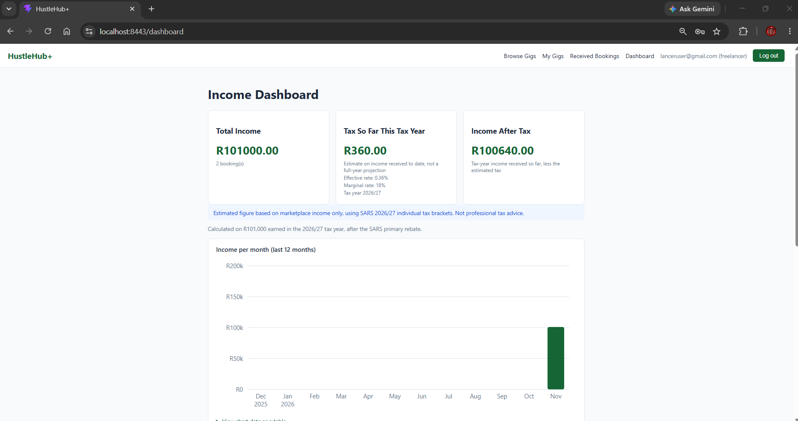
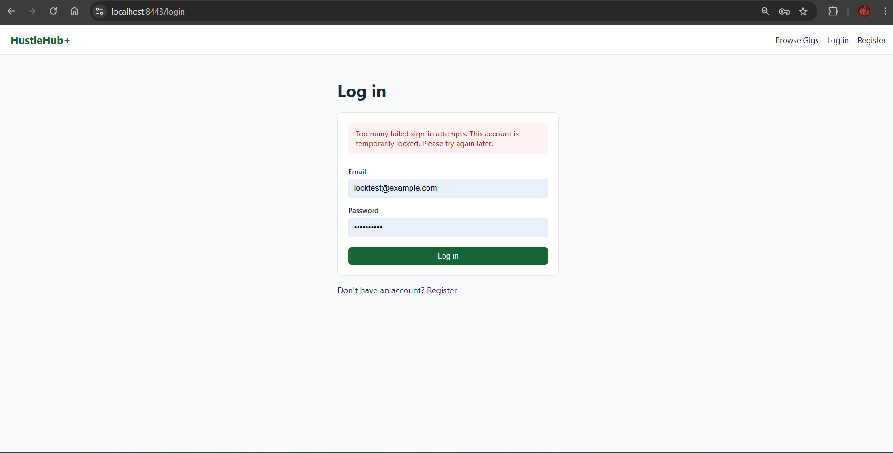
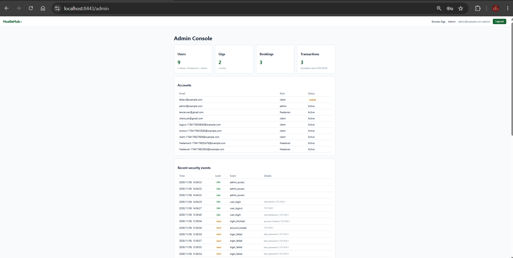
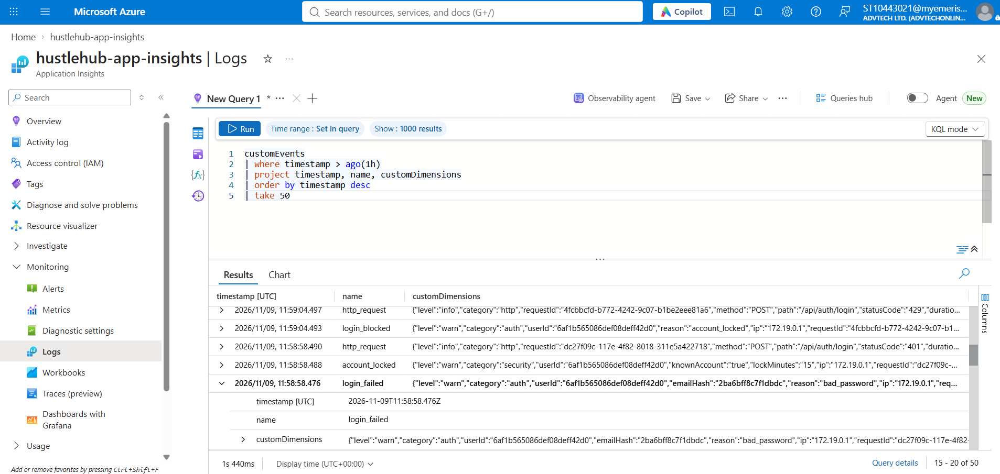
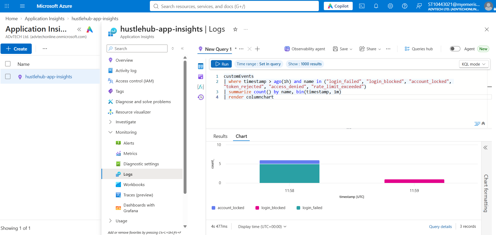
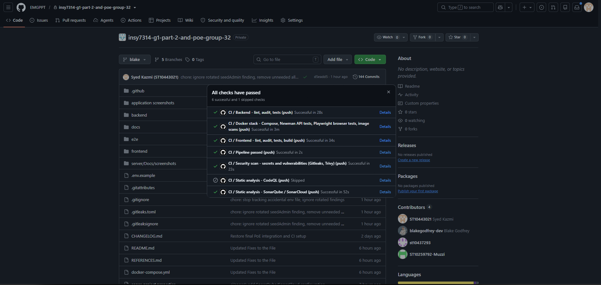
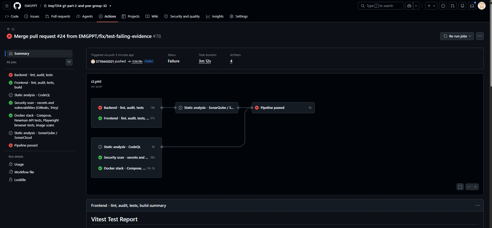
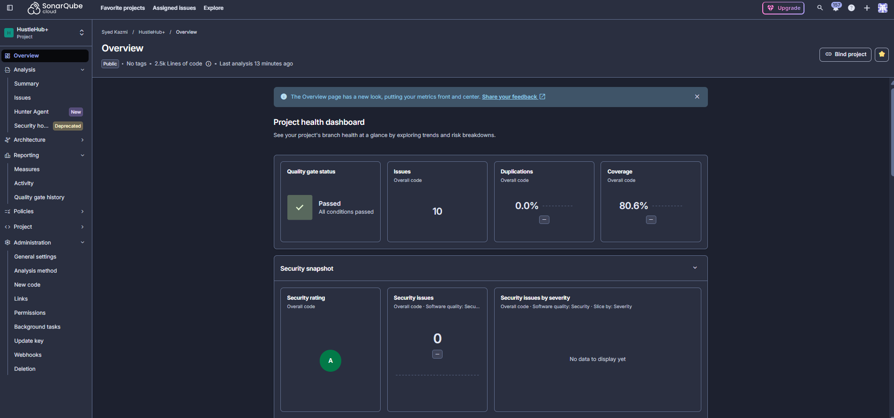
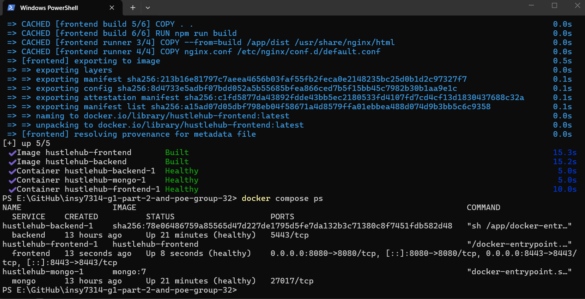
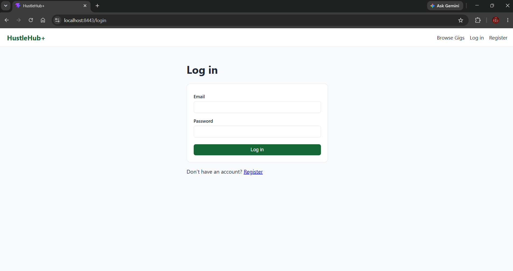

# **INSY7314 · Portfolio of Evidence · Final Submission: DevSecOps, Monitoring and Finalisation**

Team: Quantum Coders · Last updated: 8 November 2026

HustleHub+ is a secure freelance marketplace. **Freelancers** advertise gigs, **clients** browse and book them, every booking creates a **simulated-payment transaction**, and the freelancer's **income and estimated-tax dashboard** is built from those transactions. This final version adds the DevSecOps layer: an automated GitHub Actions pipeline, static analysis, containers orchestrated with Docker Compose, cloud logging, extra security features and a documented security review (IIE, 2026c).

| | |
| --- | --- |
| **Repository** | [github.com/EMGPPT/insy7314-g1-part-2-and-poe-group-32](https://github.com/EMGPPT/insy7314-g1-part-2-and-poe-group-32) |
| **Forked repository (SonarCloud and CodeQL were connected to this public fork)** | [github.com/ST10443021/hustlehub-plus-sonar](https://github.com/ST10443021/hustlehub-plus-sonar) |
| **Demonstration video (Part 3)** | _Paste the new Part 3 video link here_ |
| **Pipeline** | Repository **Actions** tab, workflow **CI** (`.github/workflows/ci.yml`) |

---

## Table of Contents

1. [Team](#1-team)
2. [What this final version adds, mapped to the rubric](#2-what-this-final-version-adds-mapped-to-the-rubric)
3. [Technology stack](#3-technology-stack)
4. [Architecture and project structure](#4-architecture-and-project-structure)
5. [Application features](#5-application-features)
6. [Tax and income dashboard](#6-tax-and-income-dashboard)
7. [Role-based access control](#7-role-based-access-control)
8. [API security, rate limiting, headers and HTTPS](#8-api-security-rate-limiting-headers-and-https)
9. [Own security features](#9-own-security-features)
10. [Logging and monitoring](#10-logging-and-monitoring)
11. [CI/CD pipeline](#11-cicd-pipeline)
12. [Static code analysis](#12-static-code-analysis)
13. [Docker and Docker Compose](#13-docker-and-docker-compose)
14. [Running the project](#14-running-the-project)
15. [Testing](#15-testing)
16. [Final security review](#16-final-security-review)
17. [API reference](#17-api-reference)
18. [Demonstration evidence](#18-demonstration-evidence)
19. [Git workflow and collaboration](#19-git-workflow-and-collaboration)
20. [AI declaration](#20-ai-declaration)
21. [Known limitations](#21-known-limitations)
22. [References](#22-references)

---

## 1. Team

| Name | Student Number | Main responsibility |
| --- | --- | --- |
| Blake Derek Godfrey | ST10435415 | Backend, auth and session, shared integration, income, security, logging, final tests, README and evidence (with Hamza) |
| Syed Muhammad Hamza Kazmi | ST10443021 | Backend, JWT/auth middleware, environment config, rate limiting, shared integration, income, security, containers, final tests, README and evidence (with Blake) |
| Connor Albertyn | ST10437293 | Frontend: `BrowseGigsPage.jsx` and `MyBookingsPage.jsx` (client browsing, booking confirmation, own bookings) |
| Muzammil Cassim | ST10259792 | Frontend: `MyGigsPage.jsx` and `ReceivedBookingsPage.jsx` (gig management, received bookings); backend error handling, HTTPS server and proxy configuration |

Per-file authorship is also recorded in header comments in the source. The shared component `frontend/src/components/BookingsPage.jsx` is used by both booking pages, so changes to it must be coordinated.

---

## 2. What this final version adds, mapped to the rubric

The brief states that Part 3 is the final submission of the **complete** application, so Parts 1 and 2 still work and are still tested (IIE, 2026c). The table shows where each rubric criterion is answered.

| Rubric criterion | Marks | What was delivered | Where |
| --- | :---: | --- | --- |
| Tax and income dashboard | 20 | SARS 2026/27 brackets and rebate, tax-year filter, per-bracket breakdown, R0 explanation, monthly income bar chart, threshold progress bar, plain-language method | [Section 6](#6-tax-and-income-dashboard) |
| CI/CD pipeline | 20 | GitHub Actions `CI` workflow: lint, audit, Jest, Vitest, builds, Newman against the running Compose stack, Playwright browser tests, Gitleaks, Trivy, CodeQL, Sonar; fails on any problem | [Section 11](#11-cicd-pipeline) |
| Static code analysis | 10 | ESLint with security plugin, SonarQube/SonarCloud with quality gate, CodeQL, Trivy, Gitleaks; results and fixes explained | [Section 12](#12-static-code-analysis) |
| Docker | 10 | Hardened Dockerfiles for API and client, Compose stack with authenticated MongoDB and health-ordered start-up, proof of healthy containers inside the pipeline | [Section 13](#13-docker-and-docker-compose) |
| Logging | 10 | Structured, redacted logs of logins, bookings, transactions and errors, shipped to Azure Application Insights; what and why explained | [Section 10](#10-logging-and-monitoring) |
| Own security features | 15 | Account lockout, server-side token revocation, JWT algorithm pinning, admin security console, pipeline secret and image scanning, uniform sign-in behaviour against user enumeration, pseudonymised log identifiers | [Section 9](#9-own-security-features) |
| Security review | 10 | Threat-to-control table covering injection, XSS, authentication, access control and the rest of the OWASP Top 10 | [Section 16](#16-final-security-review) |
| README | 5 | This document | all |
| GitHub usage | -5 to 0 | Four contributors with defined responsibilities, pull-request merges, Dependabot updates, Markdown README; commit totals are read from Git rather than quoted | [Section 19](#19-git-workflow-and-collaboration) |

---

## 3. Technology stack

| Layer | Technology |
| --- | --- |
| Frontend | React 19, React Router 7, Axios, Vite 8 |
| Backend | Node.js (≥ 22.22.2), Express 4, native `https` server |
| Database | MongoDB with Mongoose 8 (authenticated in Docker) |
| Authentication | JSON Web Tokens (`jsonwebtoken`), bcrypt (`bcryptjs`) |
| Security middleware | Helmet, CORS allow-list, `express-rate-limit`, `express-validator`, `express-mongo-sanitize`, an in-house input sanitiser (`sanitizeInput.js`) |
| Backend testing | Jest, Supertest, Postman collection, Newman |
| Frontend testing | Vitest, React Testing Library, `user-event`, jsdom, Playwright (browser) |
| Static analysis | ESLint with `eslint-plugin-security`, SonarQube/SonarCloud, CodeQL, Gitleaks, Trivy |
| Containers | Docker, Docker Compose, `nginx-unprivileged` (TLS-terminating reverse proxy) |
| CI/CD | GitHub Actions, Dependabot |
| Monitoring | Structured JSON logs, Azure Application Insights |

---

## 4. Architecture and project structure

### 4.1 Layered design

```
Browser (React SPA)
   |  HTTPS, same origin, /api
   v
nginx (TLS, HSTS, CSP)  ---HTTPS, certificate verified--->  Express API
                                                               |
   security middleware -> routes -> validators -> auth/RBAC -> controllers
                                                               v
   services (ownership, booking, transaction, income, tax, lockout) -> repositories -> MongoDB
                                                               |
   event logger -> local file + stdout + Azure Application Insights
```

Controllers stay thin (HTTP to service translation). Services hold every business and ownership rule, so a rule cannot be bypassed by calling a different route. The frontend is a convenience layer; the backend is the security boundary (OWASP, 2021).

### 4.2 Repository layout

```
HustleHub/
├── README.md                      # This document
├── REFERENCES.md                  # Full IIE Harvard reference list
├── docker-compose.yml             # mongo + backend + frontend (nginx), health-ordered
├── sonar-project.properties       # SonarQube / SonarCloud configuration
├── .gitleaks.toml                 # Secret-scanning configuration
├── .env.example                   # Compose settings template (never commit .env)
├── .github/
│   ├── workflows/ci.yml           # The CI/CD pipeline
│   └── dependabot.yml             # Automated dependency, Actions and image updates
│
├── backend/                       # Express API
│   ├── src/
│   │   ├── server.js              # HTTPS-only entry point, graceful shutdown, log flush
│   │   ├── app.js                 # Helmet + CSP, CORS, sanitisation, rate limits, routes
│   │   ├── config/                # env.js (validated settings, tax brackets), db.js
│   │   ├── routes/                # auth, gig, booking, income, admin routes
│   │   ├── middleware/            # authMiddleware (JWT + RBAC), validators, rateLimiters, errorHandler, sanitizeInput
│   │   ├── controllers/           # auth, gig, booking, income, admin (thin HTTP layer)
│   │   ├── services/              # authService, gigService, bookingService, incomeService, adminService
│   │   ├── repositories/          # user, gig, booking, transaction (Mongo; memory only under NODE_ENV=test)
│   │   ├── schemas/               # Mongoose models
│   │   └── utils/                 # eventLogger, cloudLogger, azureLogTransport, pseudonymise, identifierThrottle
│   ├── tests/                     # Jest + Supertest (9 suites, 146 tests)
│   ├── postman/                   # Postman collections (Part 3 collection: 55 requests)
│   ├── scripts/                   # generateCert, trustCert, seedAdmin, runNewman
│   ├── Dockerfile, docker-entrypoint.sh, .dockerignore
│   └── .env.example, .env.test
│
├── frontend/                      # React SPA
│   ├── src/
│   │   ├── App.jsx, main.jsx      # Route table and entry point
│   │   ├── api/client.js          # Axios, bearer token, 401 handling, safe errors
│   │   ├── context/AuthContext.jsx# Verified session, expiry timer, server-side logout
│   │   ├── components/            # Navbar, ProtectedRoute, GigCard, BookingsPage, IncomeChart, AlertMessage
│   │   ├── pages/                 # Login, Register, BrowseGigs, MyGigs, MyBookings, ReceivedBookings, Dashboard, Admin, NotFound
│   │   ├── lib/                   # validation.js, format.js
│   │   └── tests/                 # Vitest + Testing Library (13 files, 64 tests)
│   ├── nginx.conf                 # TLS, HSTS, CSP, SPA fallback, verified proxy to the API
│   ├── Dockerfile, securityHeaders.js, vite.config.js
│   └── .env.example
│
├── e2e/                           # Playwright browser tests (12 tests) run against the Compose stack
│   ├── playwright.config.js
│   └── tests/                     # marketplace.spec.js, security.spec.js, helpers.js
│
└── docs/
    ├── part3/                     # LOGGING.md, STATIC_ANALYSIS.md, EVIDENCE.md, evidence/, screenshots/
    ├── part2/                     # Dated Part 2 verification record
    └── screenshots/               # Part 1 Postman and Part 2 application screenshots
```

---

## 5. Application features

| Area | What it does |
| --- | --- |
| Authentication | Client/freelancer registration, login, verified profile, logout that ends the session on the server, automatic logout at token expiry |
| Gig management | Freelancers create, view, edit and delete **only their own** gigs |
| Marketplace | Anyone can browse active gigs (optional category filter); clients book from a confirmation dialog |
| Bookings | Client booking history; freelancer received-bookings list |
| Transactions | Every booking creates a simulated-payment transaction linked to the booking, client and freelancer |
| Income and tax | Freelancer income summed from that freelancer's transactions; SARS-based tax estimate with a visible method ([Section 6](#6-tax-and-income-dashboard)) |
| Admin console | Read-only platform totals, accounts (with lock status) and recent security events |
| Data integrity | A booking stores a **title and price snapshot**, so history stays correct after a gig is edited or deleted |
| Resilient UI | Loading, empty and error/retry states, field-level messages, and buttons disabled while a request is pending |

```
Register (freelancer) --> Log in --> Create gig
Register (client)     --> Log in --> Browse --> Confirm booking --> booking + transaction created
Freelancer --> Received Bookings --> Dashboard (income, estimated tax, chart, method)
```

---

## 6. Tax and income dashboard

### 6.1 How the estimate is calculated

The dashboard estimates the income tax on the money a freelancer has received through HustleHub+ **so far in the current South African tax year** (1 March to the end of February), using the SARS 2026/27 individual rates for taxpayers under 65 (SARS, 2026). The figure is labelled **"Tax So Far This Tax Year"** and is returned by the API as `estimatedTaxToDate`; it is deliberately not a projection of the full year, because scaling a few early bookings up to twelve months would overstate the tax badly. The code is in `backend/src/services/incomeService.js`; the tax-year, bracket and rebate settings are in `backend/src/config/env.js`.

1. **Income.** Add up every simulated booking payment received by the freelancer in the current tax year. Earlier years still count towards "total income" but are not taxed again, because SARS assesses each tax year separately (SARS, 2026).
2. **Brackets.** Apply the progressive SARS table. Each slice of income is taxed at its own rate, so only the part above a bracket's lower limit is taxed at the higher rate (SARS, 2026).

   | Taxable income (R) | Tax rate | Tax on all lower brackets (R) |
   | --- | :---: | ---: |
   | 1 – 245,100 | 18% | 0 |
   | 245,101 – 383,100 | 26% | 44,118 |
   | 383,101 – 530,200 | 31% | 79,998 |
   | 530,201 – 695,800 | 36% | 125,599 |
   | 695,801 – 887,000 | 39% | 185,215 |
   | 887,001 – 1,878,600 | 41% | 259,783 |
   | 1,878,601 and above | 45% | 666,339 |

3. **Rebate.** Subtract the primary rebate of **R17,820**. Tax can never go below R0 (SARS, 2026).
4. **Threshold.** R17,820 ÷ 18% = R99,000, so income up to R99,000 correctly produces **R0 tax**. The dashboard explains a R0 result instead of leaving it unexplained.
5. **Effective rate** = estimated tax ÷ tax-year income. The **marginal rate** is the rate on the next rand earned.

`tax = max(0, base + (income - lower limit) x rate - 17,820)`

The breakdown table on the dashboard lists the amount and tax in each bracket, and the per-bracket amounts add up exactly to the same gross tax the formula produces. The unit tests check the 2026/27 brackets, the rebate, the 1 March rollover in South African time, the R0 explanation and a non-zero estimate above the threshold.

| Tax-year income | Estimated tax | Effective rate | Marginal rate |
| ---: | ---: | ---: | ---: |
| R10,500 | R0.00 | 0.00% | 18% |
| R99,000 | R0.00 | 0.00% | 18% |
| R150,000 | R9,180.00 | 6.12% | 18% |
| R160,500 | R11,070.00 | 6.90% | 18% |
| R400,000 | R67,417.00 | 16.85% | 31% |
| R1,000,000 | R288,293.00 | 28.83% | 41% |

Worked example for R400,000: 79,998 + (400,000 − 383,100) × 0.31 = 85,237; less the rebate of 17,820 = **R67,417** (SARS, 2026).

### 6.2 What the freelancer sees

| Element | Purpose |
| --- | --- |
| Summary cards | Total income, tax so far this tax year (estimate), effective rate, marginal rate, income after tax |
| Monthly income bar chart | Income per month for the last 12 months, with zero months shown so there are no gaps (accessible SVG with a text alternative) |
| Threshold progress bar | How far tax-year income is from the R99,000 point where tax starts |
| Bracket breakdown table | Amount and tax in each bracket, gross tax, rebate and net tax |
| "How is this calculated?" | The method above in plain language; the last step states that the figure is not a full-year projection |
| Disclaimer | The API returns it with every summary: the figure covers marketplace income only and is **not professional tax advice** |

**Assumptions and limits.** The estimate covers income actually received so far this tax year (it does not project the full year); it ignores deductions, medical credits, other income and provisional-tax rules; and it assumes a taxpayer under 65 (SARS, 2026). These limits are shown to the user rather than hidden.



---

## 7. Role-based access control

Access is enforced **on the server** by `requireAuth` then `requireRole(...)`. The frontend `ProtectedRoute` only improves the user experience (OWASP, 2024j).

| Capability | Client | Freelancer | Admin |
| --- | :---: | :---: | :---: |
| Browse active public gigs | ✅ | ✅ | ✅ |
| Read own verified profile, log out | ✅ | ✅ | ✅ |
| Create / edit / delete **own** gigs | ❌ | ✅ | ❌ |
| Create and view **own** bookings | ✅ | ❌ | ❌ |
| View received bookings, own income and tax | ❌ | ✅ | ❌ |
| View platform totals, accounts and security events (read-only) | ❌ | ❌ | ✅ |

**Ownership and object-level checks**

- `gigService.assertOwnership` is re-evaluated on every update and delete; another freelancer's request returns **403**.
- A booking accepts only a `gigId`. Client identity, freelancer identity and price come from the verified token and the saved gig, never from the request body.
- Gig updates cannot change `freelancerId` or other protected fields; unknown fields are rejected with **400**.
- A user cannot book their own gig.
- Lists (`/gigs/mine`, `/bookings/mine`, `/bookings/received`, `/income/summary`) are always scoped to the authenticated user.
- The server reloads the user on every protected request to obtain the trusted role, so a stale or forged role claim in a token is ignored.

**Admin accounts.** Public sign-up accepts only `client` or `freelancer`, so an administrator cannot be created through the API. Admins are made on the server with `node scripts/seedAdmin.js`, which reads the e-mail and password from environment variables and logs the creation. The admin API is read-only: nothing it exposes can change or delete data, and password hashes and lockout counters are never returned (OWASP, 2024j).

---

## 8. API security, rate limiting, headers and HTTPS

### 8.1 Authentication and input handling

- **Passwords** are hashed with bcrypt (work factor 12). New passwords must be 8–72 characters (and no more than 72 bytes, so bcrypt never silently truncates) with an uppercase letter, a lowercase letter and a digit (OWASP, 2024a).
- **JWTs** carry only the user ID, role and token version, expire after one hour, and are verified for signature, algorithm, issuer (`hustlehub-plus-api`) and expiry on **every** protected request. Failures return one generic message so an attacker cannot tell *why* a token failed (Jones, Bradley and Sakimura, 2015).
- **Validation.** `express-validator` checks types, lengths, price range (R0–R1,000,000, two decimals), booleans and MongoDB ID format. Bodies use an allow-list of fields, are capped at 10 KB, and malformed JSON returns a clean 400 (OWASP, 2024b).
- **Sanitisation.** `express-mongo-sanitize` strips NoSQL operators (`$gt`, `$ne`). `sanitizeInput.js` escapes `<` in every string of the body and query as defence in depth; it replaced the unmaintained `xss-clean` package, which also rewrote passwords containing `<`, and it never touches passwords. The **real** cross-site-scripting controls are output encoding (React renders every value as text) and the Content Security Policy in Section 8.3 (OWASP, 2024g; OWASP, 2024h).
- **Uniform sign-in behaviour.** A wrong password, an unknown email and a locked account cannot be told apart by status, message or response time (Section 9, feature 6) (OWASP, 2024k).
- **Safe errors.** A central handler returns only intentionally exposed messages. Stack traces, driver errors, file paths and connection strings never reach the client. Each response carries an `X-Request-Id` header, and the same ID appears in the related log lines (OWASP, 2021).
- **Start-up checks.** The app refuses to start if `JWT_SECRET` is missing, shorter than 32 characters or still the placeholder, or if MongoDB is unreachable. In-memory repositories exist **only** under `NODE_ENV=test`.

### 8.2 Rate limiting

| Scope | Limit | Window | Response when exceeded |
| --- | --- | --- | --- |
| Global (all routes) | 300 requests | 15 min | **429** |
| `POST /api/auth/register`, `POST /api/auth/login` | 20 requests | 15 min | **429** `Too many attempts. Please try again later.` |
| `POST /api/bookings` | 10 requests (configurable) | 15 min | **429** `Too many booking attempts. Please try again later.` |

Standard `RateLimit-*` headers are returned. Limiters are skipped **only** when `NODE_ENV=test`; the Newman collection proves them against the live API by repeating requests until a 429 arrives. Each rejection is logged as `rate_limit_exceeded`. `TRUST_PROXY=1` is set only behind the controlled nginx proxy, so a client cannot spoof its address (OWASP, 2021).

### 8.3 Security headers and Content Security Policy

```
default-src 'self'; script-src 'self'; style-src 'self' 'unsafe-inline';
img-src 'self' data:; connect-src 'self'; object-src 'none';
frame-ancestors 'none'; base-uri 'self'; form-action 'self'; upgrade-insecure-requests
```

Scripts are never inline and no third-party origin is allowed. Inline styles are permitted only because React injects component styles. Helmet also sets HSTS, `X-Content-Type-Options: nosniff` and `Cross-Origin-Resource-Policy`. CORS is an explicit origin allow-list, never a wildcard (Mozilla, 2026b). nginx adds the same CSP plus HSTS, `X-Frame-Options: DENY` and `Referrer-Policy` for the containerised front end.

### 8.4 HTTPS

The API binds to Node's native `https` module and **never falls back to HTTP**. `npm run gen-cert` creates a small local Certificate Authority and a `localhost` certificate (SAN: `localhost`, `backend`, `127.0.0.1`, `::1`), and `npm run trust-cert` adds the CA to the operating-system trust store so browsers show a padlock (Cooper et al., 2008; Mozilla, 2026a; Valsorda, n.d.). nginx verifies the API's certificate against that CA instead of disabling verification, so traffic is encrypted and authenticated on both hops. Certificates are for local development only and are git-ignored; production would use a public CA such as Let's Encrypt (Let's Encrypt, n.d.).

---

## 9. Own security features

These features go **beyond** the minimum requirements in the brief (validation, hashing, JWT, RBAC, rate limiting, headers, HTTPS), are functional, and are tested. They are listed here so they are easy to mark (IIE, 2026c).

| # | Own security feature | Where | Tests |
| --- | --- | --- | --- |
| 1 | **Account lockout** after repeated failed sign-ins | Backend | `securityFeatures.test.js`, Newman folder 6, Playwright lockout test |
| 2 | **Server-side token revocation (real logout)** | Backend and frontend | `securityFeatures.test.js`, Newman folder 6, Playwright revocation test |
| 3 | **JWT algorithm pinning and token versioning** | Backend | `securityFeatures.test.js` |
| 4 | **Admin security console** (read-only, security-event view) | Backend and frontend | `Admin.test.jsx`, Newman folder 6, Playwright admin test |
| 5 | **Pipeline secret scanning, image scanning and automated dependency updates** | Pipeline | `repo-scan` and `stack` jobs, `dependabot.yml` |
| 6 | **Uniform sign-in behaviour against user enumeration** (same lockout, same timing, same messages for real and unknown emails) | Backend | `hardening.test.js` |
| 7 | **Pseudonymised log identifiers** (e-mail addresses stored only as a keyed hash) | Backend | `logging.test.js`, `hardening.test.js` |

**1. Account lockout.** After 5 failed sign-ins (`LOCKOUT_MAX_ATTEMPTS`) an account is locked for 15 minutes (`LOCKOUT_MINUTES`). While locked, the password is not even checked, so a guessed password cannot unlock the account early; the API answers **429** with a `Retry-After` header, and the failure counter restarts when the lock is applied and is cleared by a successful sign-in. This defeats slow online guessing that stays under the IP rate limit, such as an attacker rotating addresses against one account. The events `login_failed`, `account_locked` and `login_blocked` are logged, and the admin console shows which accounts are locked. Unknown email addresses are counted and locked in exactly the same way (feature 6), so the lockout itself cannot be used to discover which emails exist (OWASP, 2024c; Grassi et al., 2017).

**2. Server-side token revocation.** A JWT normally stays valid until it expires, even after the user "logs out" in the browser. Each user has a token version stored in the database and copied into every token; `POST /api/auth/logout` raises the version, so every earlier token is rejected immediately and the front end also clears its local session. A stolen token therefore stops working as soon as the owner logs out (OWASP, 2024e).

**3. JWT algorithm pinning.** Tokens are signed and accepted only with HS256, and the verifier names the allowed algorithm, which closes the "algorithm confusion" and `alg: none` attacks. Issuer, expiry and token version are checked on every request (Jones, Bradley and Sakimura, 2015; OWASP, 2024e).

**4. Admin security console.** An administrator sees platform totals, a list of accounts (role, locked or not, created date) and the latest security events (failed logins, lockouts, rejected tokens, denied access, rate-limit hits). It is read-only, protected by `requireRole('admin')`, never shows password hashes or counters, and every use is logged as `admin_access`. This gives the team a way to spot attacks without server access (OWASP, 2024d; OWASP, 2024j).

**5. Pipeline security.** Gitleaks scans the entire git history for committed secrets, Trivy scans dependencies, Dockerfiles and both built images, and Dependabot opens weekly pull requests for outdated npm packages, GitHub Actions and base images. Secrets used by the pipeline are generated for each run and masked in the log (Gitleaks, n.d.; Aqua Security, n.d.; GitHub, n.d.a; GitHub, n.d.b).

**6. Uniform sign-in behaviour (anti-enumeration).** The final review found three ways to tell a registered email from an unregistered one: a locked real account answered **429** while an unknown email always answered **401**; the unknown-email path skipped bcrypt and so answered faster; and the token middleware said "User for this token no longer exists". All three are closed. Unknown emails now follow the same five-failure lockout (`identifierThrottle.js`, a bounded in-memory table keyed by a SHA-256 of the address, never the address itself); they are compared against a real bcrypt hash made at start-up, so the work and the response time match a wrong password; and the token middleware gives the same "Invalid or expired token." for every failure, keeping the real reason in the log only. The test `hardening.test.js` runs a real and an unknown address side by side and requires identical status codes, messages and `Retry-After` behaviour at every step (OWASP, 2024a; OWASP, 2024k).

**7. Pseudonymised log identifiers.** Failed sign-ins used to be logged with the raw email. That is personal information under POPIA, and users sometimes type a password into the email box. The logger now replaces any email-named field with `emailHash`, the first 16 hex characters of an HMAC-SHA-256 whose key is derived from `JWT_SECRET`, so the same address always gives the same value (attempts can still be grouped and investigated) but the address cannot be read back or looked up in a precomputed table. Rotating `JWT_SECRET` changes the pseudonyms, which is acceptable for a security log (OWASP, 2024d; Republic of South Africa, 2013).





---

## 10. Logging and monitoring

### 10.1 What is logged

`backend/src/utils/eventLogger.js` writes one JSON line per event with a timestamp, level, category, request ID and event-specific fields (OWASP, 2024d). The required categories are covered:

| Category | Events | Level | Why it matters |
| --- | --- | --- | --- |
| **Login attempts** | `user_registered`, `user_login`, `login_failed` (with reason), `login_blocked`, `user_logout` | info / warn | Failed-login bursts reveal password guessing and credential stuffing; successful logins give an audit trail |
| **Account protection** | `account_locked`, `token_rejected`, `access_denied`, `rate_limit_exceeded`, `admin_access` | warn / info | Shows attacks being stopped and shows who used privileged features; spikes mean an attack in progress |
| **Bookings** | `booking_created` (booking, gig, client and freelancer IDs) | info | Proves each booking happened and who was involved; supports disputes and fraud checks |
| **Transactions** | `transaction_created` (transaction, booking, amount, parties) | info | The financial audit trail behind every freelancer's income figure |
| **Gigs** | `gig_created`, `gig_updated`, `gig_deleted` | info | Detects tampering with listings |
| **Errors** | `server_error`, `booking_cleanup_failed` | error | Unhandled failures and failed clean-ups need a person to look at them |
| **System** | `server_started`, `server_stopping`, `http_request` (method, path, status, user) | info | Shows restarts and request patterns on authentication and booking endpoints |

A real sample taken from the Newman run against the live HTTPS API on 8 November 2026 is in `docs/part3/evidence/logging-sample.jsonl` (the email appears only as `emailHash`):

```json
{"timestamp":"2026-11-08T08:57:11.079Z","level":"warn","category":"auth","event":"login_failed","userId":"6af0396601e31f0ffe404fba","emailHash":"1cadb89afb7624ef","reason":"bad_password","ip":"127.0.0.1","requestId":"f6ef0031-ee6b-4539-801e-c79e088dc6ae"}
{"timestamp":"2026-11-08T08:57:12.857Z","level":"warn","category":"security","event":"account_locked","userId":"6af0396801e31f0ffe404ff2","knownAccount":true,"lockMinutes":15,"ip":"127.0.0.1","requestId":"868b81df-78c5-457d-9c07-172d2e4836ad"}
{"timestamp":"2026-11-08T08:57:11.552Z","level":"info","category":"transaction","event":"transaction_created","transactionId":"6af0396701e31f0ffe404fd5","bookingId":"6af0396701e31f0ffe404fd3","clientId":"6af0396601e31f0ffe404fba","freelancerId":"6af0396601e31f0ffe404fb2","amount":1750,"requestId":"ea76b34c-48a7-4804-a79e-22b8ee7c6b87"}
```

### 10.2 Why these logs matter for monitoring and security

- **Detection.** Authentication failures, lockouts, rejected tokens and denied access are the early signs of guessing, token theft and privilege abuse; without logs these attacks are invisible (OWASP, 2024d).
- **Investigation.** The request ID is returned to the client in the `X-Request-Id` response header and written to every related log line, so one failing request can be followed across the API and the logs.
- **Accountability.** Bookings and transactions are financial events; recording who did what, and when, supports disputes and audit.
- **Operations.** `server_error` entries and container health show failures before users report them.
- **Privacy by design.** Logs never contain passwords, hashes, tokens, authorization headers, cookies or request bodies. E-mail addresses are personal information under POPIA and are sometimes mistyped passwords, so they are stored only as a keyed hash (`emailHash`) (Republic of South Africa, 2013; OWASP, 2024d). Any field whose name looks sensitive is replaced with `[REDACTED]`, long values are truncated and credentials inside connection strings are masked, so the log cannot become a new source of data leakage (OWASP, 2021; OWASP, 2024d).

### 10.3 Where the logs go

| Destination | Purpose |
| --- | --- |
| `backend/logs/events.log` (rotates at 5 MB; a named Docker volume in Compose) | Local record that survives a cloud outage |
| Standard output in production | Collected by Docker as container logs (Wiggins, 2017) |
| **Azure Application Insights** (cloud) | Searchable, chartable, alertable cloud log platform; each event is a custom event with its fields as properties (Microsoft, n.d.a; Microsoft, n.d.b) |

Shipping is buffered, batched and retried, never blocks a request, and flushes on shutdown. Setup, the Kusto queries used for the screenshots and an optional alert rule are in [`docs/part3/LOGGING.md`](docs/part3/LOGGING.md). Azure Application Insights is the single cloud provider used by this submission; it satisfies the "cloud-based logging" requirement, and Azure Monitor data can also be surfaced in Grafana if a Grafana dashboard is wanted (IIE, 2026c).





---

## 11. CI/CD pipeline

The pipeline is a GitHub Actions workflow, `.github/workflows/ci.yml`, named **CI**. It runs automatically on every push, every pull request and on demand, and its results are on the repository's **Actions** tab (GitHub, n.d.d).

```
push / pull request
   |
   +-- backend ............ npm ci, ESLint, npm audit, Jest + coverage
   +-- frontend ........... npm ci, ESLint, npm audit, Vitest + coverage, production build
   +-- static-analysis .... SonarQube / SonarCloud + quality gate   (needs backend, frontend coverage)
   +-- codeql ............. CodeQL security-extended queries        (public repositories)
   +-- repo-scan .......... Gitleaks (git history), Trivy (packages, secrets, Dockerfiles)
   +-- stack .............. docker compose up --build --wait
   |                        health proof, HTTPS proof, Newman API tests,
   |                        Playwright browser tests, Trivy image scans
   +-- pipeline-passed .... fails the workflow if any required job failed
```

| Job | What it does | Fails the build when |
| --- | --- | --- |
| `backend` | Installs with `npm ci`, runs ESLint with the security plugin, `npm audit`, and the 146 Jest tests with coverage | Any lint warning, a HIGH/CRITICAL production advisory, or one failing test |
| `frontend` | Installs, lints, audits, runs the 64 Vitest tests with coverage, then builds the production bundle | Same as above, or the build fails |
| `static-analysis` | Runs the Sonar scanner on both applications with their coverage and waits for the quality gate | The quality gate fails, **or `SONAR_TOKEN` / `SONAR_ORGANIZATION` is missing** (Dependabot and fork pull requests, which GitHub gives no secrets, are the only exception) |
| `codeql` | Runs CodeQL with the `security-extended` query pack (skipped on private repositories, where CodeQL needs a paid licence) | A code-scanning alert is raised |
| `repo-scan` | Gitleaks over the full history; Trivy over packages, secrets and Dockerfiles | A secret is found, or a fixable HIGH/CRITICAL finding exists |
| `stack` | Generates throw-away certificates and secrets; builds and starts MongoDB, the API and the client with Compose and waits until all are **healthy**; checks HTTPS with a verified certificate chain; seeds an admin; runs the **Newman** collection through nginx; restarts the API to reset rate-limit counters; runs the **Playwright** tests in Chromium; scans both images with Trivy; uploads evidence; always tears the stack down | A container never becomes healthy, a Newman assertion or Playwright test fails, or an image has a fixable CRITICAL vulnerability |
| `pipeline-passed` | One final check that reads the result of every job above | Any required job failed or was cancelled; the only job that may be skipped is CodeQL on a private repository |

**Why it cannot report false success.** Each scanner step runs under `shell: bash`, which enables `pipefail`, so a failing scanner can never be hidden by piping its output through `tee`. Test commands exit non-zero on failure, and `pipeline-passed` runs with `if: always()` so a failed or cancelled job cannot be skipped over. The Sonar job fails when it is not configured, so a green run can never mean that static analysis was skipped (GitHub, n.d.d; OWASP, 2024i).

**Secrets.** No credential is written in the workflow or the repository. The `stack` job generates a JWT secret, a MongoDB password and an admin password for each run, masks them in the log (`::add-mask::`) and discards them with the runner. The repository needs the secret `SONAR_TOKEN` and the variable `SONAR_ORGANIZATION` (optionally `SONAR_PROJECT_KEY` and `SONAR_HOST_URL`, see Section 12); cloud-logging credentials are deliberately **not** given to the pipeline, so test traffic never reaches the production log workspace (GitHub, n.d.a).

**Dependencies stay patched.** `.github/dependabot.yml` opens weekly pull requests for the backend, frontend and e2e npm packages, GitHub Actions and the Docker base images. They run through this same pipeline before merging (GitHub, n.d.b).

**Running the same checks locally**

```bash
cd backend  && npm ci && npm run lint && npm run audit && npm run test:coverage
cd frontend && npm ci && npm run lint && npm run audit && npm run test:coverage && npm run build
```

**Recommended repository setting.** Under Settings, Branches, require the status check **Pipeline passed** before merging into `main`, so red code cannot be merged.





---

## 12. Static code analysis

Static analysis runs inside the pipeline on every push (see [Section 11](#11-cicd-pipeline)). The full explanation, results and fix list are in [`docs/part3/STATIC_ANALYSIS.md`](docs/part3/STATIC_ANALYSIS.md); the summary is below (SonarSource, n.d.; ESLint, n.d.; eslint-community, n.d.).

| Tool | Latest result | Evidence |
| --- | --- | --- |
| ESLint + `eslint-plugin-security`, backend and frontend, `--max-warnings 0` | 0 problems (8 Nov 2026) | `docs/part3/evidence/backend-lint.txt`, `frontend-lint.txt` |
| `npm audit` (production, fails on HIGH) | 0 vulnerabilities in both applications (8 Nov 2026) | `docs/part3/evidence/npm-audit.txt` |
| Gitleaks, whole git history | No leaks found (7 Nov 2026, 80 commits) | `docs/part3/evidence/gitleaks-local.txt` |
| Trivy secrets and Dockerfile misconfiguration | 0 findings; both Dockerfiles clean (7 Nov 2026, before the Dockerfile change below; re-run by the pipeline) | `docs/part3/evidence/trivy-repo-local.txt` |
| SonarQube / SonarCloud quality gate | Required: the `static-analysis` job fails the pipeline if Sonar is not configured. The gate result is the screenshot below | Dashboard screenshot below |
| CodeQL | Runs in the `codeql` job on public repositories | Repository Security tab |

**What the results mean.** A clean ESLint run with the security plugin means none of the dangerous patterns it knows (object-injection sinks, non-literal file paths, unsafe regular expressions, `eval`) exist unexplained; the only four suppressions each carry a written reason and cannot be reached with user input. Zero audit findings mean no known-vulnerable production dependency ships. No secrets in the history and clean Dockerfiles mean the repository and images are safe to publish. Coverage (84% of backend lines, 89% of frontend lines) is reported to Sonar so untested code is visible.

**Fixes made because of the analysis and review**

| Finding | Fix |
| --- | --- |
| Non-literal file paths (`security/detect-non-literal-fs-filename`) | Paths come only from operator-set environment values and fixed file names; each suppression states why, and no request data reaches a path |
| Child-process arguments in the certificate-trust script | `execFileSync` with an argument array and no shell, so values cannot become commands |
| No gate on dependency advisories | `npm run audit` fails the build on HIGH or CRITICAL advisories |
| Secrets could be committed by accident | Gitleaks runs on the full history; `.env`, `*.pem` and logs are git-ignored |
| MongoDB ran without authentication and was published to the host | Authentication is required and the port is no longer published |
| Scanner failures could be masked by a pipe | Explicit `shell: bash` (`pipefail`) in scan steps |
| The local CA private key was written into the API image at build time (a secret in an image layer) | Nothing is generated at build time. `docker-entrypoint.sh` makes a throw-away certificate at start-up only when none is mounted and deletes the CA key straight after signing; `hardening.test.js` fails if a build step creates keys again |
| Sonar was skipped silently when its token was missing, so the pipeline could be green with no static analysis | The job now fails unless `SONAR_TOKEN` and `SONAR_ORGANIZATION` are set (Dependabot and fork pull requests excepted); `SONAR_PROJECT_KEY` overrides the project key |
| User enumeration: locked accounts answered 429 but unknown emails 401; unknown emails skipped bcrypt; the token middleware revealed deleted accounts | Same lockout for unknown emails, a dummy bcrypt comparison, and one generic token error (Section 9, feature 6) |
| Raw email addresses written to the log on failed sign-ins (POPIA) | Stored only as a keyed hash, `emailHash` (Section 9, feature 7) |
| Unmaintained `xss-clean` dependency that also altered passwords | Replaced by `sanitizeInput.js`; README now names React's escaping and the CSP as the real XSS controls |
| Dashboard label "Estimated Annual Tax" although the figure covers income received so far | Renamed "Tax So Far This Tax Year" (API field `estimatedTaxToDate`), with a hint and a method step saying it is not a projection |



---

## 13. Docker and Docker Compose

Both applications are containerised, each with its own Dockerfile in its own folder, and Docker Compose runs the whole stack (Docker, Inc., n.d.b).

| Image | Dockerfile | How it is built and hardened |
| --- | --- | --- |
| **API** | `backend/Dockerfile` | Multi-stage on `node:24-alpine`; production dependencies only; runs as the non-root `node` user; `HEALTHCHECK` calls `/health` over HTTPS; **no private key is created at build time**, and `docker-entrypoint.sh` generates a throw-away certificate at start-up only if none is mounted (Docker, Inc., n.d.d) |
| **Client** | `frontend/Dockerfile` | Builds with Node, then serves the static files from `nginxinc/nginx-unprivileged` as the non-root `nginx` user (no Node.js in the runtime image); `HEALTHCHECK` on `/healthz` |
| **Database** | `mongo:7` image in Compose | Root user and password required; not published to the host |

`docker-compose.yml` starts three services in a safe order, each waiting for the previous one to be **healthy**, not merely started (Docker, Inc., n.d.c):

```
mongo (healthy)  -->  backend (healthy)  -->  frontend (healthy)
```

- **Single public entry point.** Only nginx is published: `https://localhost:8443` (the app) and `http://localhost:8080` (redirects to HTTPS). The API and MongoDB are reachable only on the private Compose network, which is why the API can safely trust the proxy's forwarded client address (`TRUST_PROXY=1`) (OWASP, 2024f).
- **Authenticated database.** MongoDB runs with a root user and a password from the root `.env`; the API connects with `authSource=admin` (MongoDB, Inc., n.d.b).
- **Verified TLS on both hops.** nginx terminates browser TLS, then calls the API over HTTPS and verifies its certificate against the local CA (`proxy_ssl_verify on`) (nginx, n.d.).
- **No secrets in files.** `JWT_SECRET` and `MONGO_PASSWORD` are required (Compose refuses to start without them) and come from the git-ignored root `.env`; certificates are mounted read-only; logs are written to a named volume (GitHub, n.d.a).
- **No keys inside images.** Certificates are mounted from the host at run time. An earlier version generated the local CA at build time, which left the CA's private key in an image layer; the entrypoint now creates a temporary certificate only when none is mounted and deletes the CA key immediately (OWASP, 2024f; Docker, Inc., n.d.d).
- **Extra hardening.** `no-new-privileges` on every container, non-root users, health checks, and the API flushes its log buffer on `SIGTERM` when `docker stop` is used (Docker, Inc., n.d.a).

### 13.1 Run the stack

```bash
# 1. Certificates (mounted read-only into the containers)
cd backend && node scripts/generateCert.js && cd ..
chmod 644 backend/certs/*.pem          # Linux/macOS only: containers run as non-root users

# 2. Settings: copy the template and set JWT_SECRET and MONGO_PASSWORD
cp .env.example .env
#    JWT_SECRET     = output of: openssl rand -hex 32
#    MONGO_PASSWORD = output of: openssl rand -hex 24

# 3. Build and start; --wait returns only when all three containers are healthy
docker compose up --build -d --wait
docker compose ps
```

On Windows PowerShell use `Copy-Item .env.example .env` and `cd backend; npm.cmd run gen-cert; cd ..`; the `chmod` step is not needed on Docker Desktop. Open **https://localhost:8443** (run `npm run trust-cert` in `backend/` once so the browser trusts the local CA). Stop with `docker compose down`; add `-v` to also delete the database and log volumes. If you ran an earlier version of this stack, run `docker compose down -v` once so MongoDB is re-created with the new password.

### 13.2 Proof that the containers run in the pipeline

The `stack` job runs exactly the steps above on a clean GitHub runner and keeps the proof as downloadable artifacts: `docker-compose-ps.txt` (all three services `healthy`), `https-health.json` (the API answering through nginx with a verified certificate chain), the Newman and Playwright results (which exercise the containers end to end), `container-logs.txt` and the `events.log` read from inside the API container.





---

## 14. Running the project

### Prerequisites

Node.js ≥ 22.22.2 (Node 24 used for checks), npm, OpenSSL, and either MongoDB (local service or Atlas) or Docker Desktop. Commands below use macOS/Linux style; on **Windows PowerShell** use `npm.cmd` instead of `npm`.

### Option A: Run locally

```bash
# Backend
cd backend
npm ci
cp .env.example .env            # set JWT_SECRET (at least 32 random characters) and MONGODB_URI
npm run gen-cert                # creates certs/rootCA.pem, cert.pem, key.pem
npm run trust-cert              # trust the local CA (Windows asks you to confirm)

# Frontend
cd ../frontend
npm ci
npm run build

# Start (the backend serves the built React app on the same HTTPS origin)
cd ../backend
npm start                       # https://localhost:5443
```

Optionally create an administrator with `ADMIN_EMAIL=you@example.com ADMIN_PASSWORD='...' npm run seed-admin`. For frontend development run `npm run dev` in `frontend/` (HTTPS on `https://localhost:5173`, proxying `/api` to the backend). After `trust-cert`, fully close and reopen the browser; Firefox needs `security.enterprise_roots.enabled` in `about:config` or a manual import of `certs/rootCA.pem`.

### Option B: Docker Compose

See [Section 13.1](#131-run-the-stack).

### Environment variables (`backend/.env`)

| Variable | Purpose | Default / example |
| --- | --- | --- |
| `PORT` | HTTPS port | `5443` |
| `NODE_ENV` | `development`, `production` or `test` | `development` |
| `JWT_SECRET` | Token signing secret (≥ 32 chars, required) | none |
| `JWT_EXPIRES_IN` | Token lifetime | `1h` |
| `SSL_KEY_PATH`, `SSL_CERT_PATH` | HTTPS key and certificate | `./certs/key.pem`, `./certs/cert.pem` |
| `BCRYPT_SALT_ROUNDS` | bcrypt work factor | `12` |
| `MONGODB_URI` | MongoDB connection (required) | `mongodb://localhost:27017/hustlehub` |
| `CORS_ORIGINS` | Comma-separated allowed origins | `https://localhost:5173,https://localhost:5443` |
| `BOOKING_RATE_LIMIT_WINDOW_MS` / `_MAX` | Booking limiter | `900000` / `10` |
| `TRUST_PROXY` | `1` only behind the controlled proxy | `false` |
| `LOCKOUT_MAX_ATTEMPTS` / `LOCKOUT_MINUTES` | Account lockout | `5` / `15` |
| `APPLICATIONINSIGHTS_CONNECTION_STRING` | Azure cloud logging (optional) | empty |
| `LOG_DIR` | Local event log folder | `backend/logs` |

Never commit `.env` files or private keys. In CI and Docker the secrets are injected from the environment.

---

## 15. Testing

| Layer | Tool | Count | Where it runs |
| --- | --- | ---: | --- |
| Backend unit and integration | Jest + Supertest | 146 tests, 9 suites | `backend` job |
| Frontend component | Vitest + React Testing Library | 64 tests, 13 files | `frontend` job |
| API end to end | Postman collection + Newman | 55 requests, 90 assertions | `stack` job, and locally with `npm run test:api` |
| Browser end to end | Playwright (Chromium) | 12 tests, 2 files | `stack` job, and locally in `e2e/` |

### 15.1 Backend: Jest and Supertest

`cd backend && npm test` runs against isolated in-memory repositories (`NODE_ENV=test`). Suites: `api` (registration, login, protected routes, gig, booking, income), `gigManagement` (ownership, edit and delete rules), `security` (tampering, snapshots, safe errors, forwarded IPs), `securityFeatures` (lockout and its reset, logout revocation, `alg: none` and wrong-algorithm tokens, admin RBAC and data exposure), `injection` (NoSQL operators in login, browse and gig bodies, script tags, `__proto__`, role and ownership injection, oversized bodies and passwords), `income` (SARS brackets, tax-year boundaries, R0 explanation), `logging` (redaction of sensitive fields and connection strings, truncation, event categories, HTTP batching and retry) `azureLogging` (Azure payload format, partial-batch retry, bounded queue, shutdown flush) and `hardening` (real and unknown emails behave identically, one generic token error, the input sanitiser never alters passwords, and the Docker build creates no private key). Result: **146 of 146 pass**; coverage is 84% of lines (`docs/part3/evidence/backend-tests.txt`).

### 15.2 Frontend: Vitest and React Testing Library

`cd frontend && npm test` renders the real components and drives them with user events: registration and login validation, session expiry and verified sessions, gig create/edit/delete with confirmation, booking confirmation, booking history and retry states, the income dashboard and bar chart, and the admin console. Result: **64 of 64 pass**; coverage is 89% of lines (`docs/part3/evidence/frontend-tests.txt`).

### 15.3 API: Postman and Newman

`backend/postman/HustleHub_Part3.postman_collection.json` holds 55 requests in eight folders: auth setup, gig management with RBAC and ownership, bookings and transactions, income, gig deletion, Part 3 security features (lockout, logout revocation, admin RBAC, analytics), rate limiting and API security headers. `npm run test:api` runs it with Newman and writes a token-free summary. Rate-limit requests repeat until a 429 arrives, so 55 requests become **67 executed requests with 90 assertions and 0 failures** against the API with a MongoDB-compatible database over HTTPS (`docs/part3/evidence/newman-local-run.txt`). In the pipeline the same collection runs against the Docker stack through nginx with `NEWMAN_BASE_URL=https://localhost:8443`. The collection uses the whole sign-in rate-limit allowance (20 requests per window), so the enumeration checks live in the Jest `hardening` suite instead.

### 15.4 Browser: Playwright

`e2e/` drives the real application in Chromium: the full journey (register and log in as freelancer, create a gig with client-side validation, register and log in as client, book through the confirmation dialog, see the booking, then see the income, tax, chart and method on the freelancer dashboard) and the security behaviour (route guards, 403s from the API for the wrong role, CSP and HSTS headers, hostile markup shown as text, account lockout in the browser, token revocation after logout, admin console). Run it against a running stack:

```bash
cd e2e && npm ci && npx playwright install chromium
E2E_BASE_URL=https://localhost:8443 npx playwright test       # add E2E_ADMIN_EMAIL / E2E_ADMIN_PASSWORD for the admin check
```

The tests create their own uniquely named accounts, stay inside the 20-request sign-in rate limit, and save screenshots to `e2e/evidence/` (Playwright, n.d.).

### 15.5 Verification status

| Check | Status |
| --- | --- |
| Backend tests (146), frontend tests (64), both ESLint runs, both audits, frontend build, Newman against the live HTTPS API | Run and passing on 8 November 2026 (`docs/part3/evidence/`) |
| Gitleaks (80 commits), Trivy secrets and Dockerfile scan | Run on 7 November 2026; run again by the `repo-scan` job on every push |
| Docker Compose stack, Playwright tests, Trivy image scans, Sonar quality gate, Azure ingestion | Executed by the pipeline and by the team's own Azure and Sonar accounts; see the pipeline run and the screenshots listed in [Section 18](#18-demonstration-evidence) |

---

## 16. Final security review

Each row maps a threat to the controls that stop it, where the control lives, and how it is tested. The structure follows the OWASP Top 10 (2021) (OWASP, 2021).

| Threat | How HustleHub+ defends | Where | Verified by |
| --- | --- | --- | --- |
| **Injection** (NoSQL operators, mass assignment, command and path injection) | Every field is type- and length-checked against an allow-list; unknown fields are rejected; `express-mongo-sanitize` strips `$` operators; Mongoose schemas fix field types; there is no SQL, no `eval`, and no request data reaches a shell command or file path (the only child process uses an argument array) | `validators.js`, `app.js`, schemas, ESLint security rules | `injection.test.js`, Newman, ESLint security rules on every run, Sonar and CodeQL (Section 12) |
| **Cross-site scripting** | React renders every value as text, which is the primary control; the CSP allows scripts only from the site itself (no inline scripts, no third-party origins), forbids plugins (`object-src 'none'`) and framing (`frame-ancestors 'none'`); `sanitizeInput.js` also escapes `<` on input as defence in depth | `sanitizeInput.js`, `app.js`, `nginx.conf`, React pages | `injection.test.js`, Playwright hostile-title and CSP tests |
| **Authentication weaknesses** | bcrypt (cost 12) with a password policy; one generic error, one lockout rule and one response time for an unknown user, a wrong password and a locked account (no user enumeration); account lockout; rate limits on sign-in; JWT pinned to HS256 with issuer, one-hour expiry and token version; real logout that revokes tokens; secret strength enforced at start-up; HTTPS only with HSTS | `authService.js`, `rateLimiters.js`, `env.js` | `securityFeatures.test.js`, `hardening.test.js`, Newman folder 6, Playwright lockout and logout tests |
| **Broken access control** | Server-side `requireRole` on every protected route; ownership re-checked on every gig update and delete; identities and prices taken from the token and database, never the body; lists scoped to the caller; admin accounts cannot be self-registered and the admin API is read-only; role reloaded from the database on each request | `authMiddleware.js`, `gigService.js`, `bookingService.js`, `adminService.js` | `api`, `gigManagement`, `security` suites; Newman RBAC folders; Playwright 403 checks |
| **Sensitive data exposure** | TLS on both hops with HSTS; password hashes, tokens and lockout counters never returned or logged; email addresses logged only as a keyed hash; log fields named like secrets are redacted and connection-string credentials masked; errors never include stack traces, paths or driver messages; secrets only in environment variables | `eventLogger.js`, `errorHandler.js`, nginx, compose | `logging.test.js`, `security.test.js`, Gitleaks |
| **Security misconfiguration** | Helmet and an explicit CSP; CORS allow-list, no wildcard; fail-fast configuration; MongoDB authenticated and unpublished; non-root containers with `no-new-privileges`; proxy trust only behind nginx | `app.js`, Dockerfiles, `docker-compose.yml` | Newman "API Headers", Playwright header test, Trivy |
| **Vulnerable and outdated components** | `npm audit` gate, Dependabot weekly updates, lockfile installs with `npm ci`, Trivy scans of packages and both images | `ci.yml`, `dependabot.yml` | Pipeline; `npm-audit.txt` |
| **Logging and monitoring failures** | Logins, failures, lockouts, rejected tokens, denied access, bookings, transactions, errors and admin use are logged with request IDs and shipped to Azure; the admin console surfaces recent security events | `eventLogger.js`, `cloudLogger.js` | `logging.test.js`, `azureLogging.test.js`; live Azure queries in Section 18 |
| **Software and data integrity** | Gitleaks and Trivy in the pipeline; CI uses throw-away secrets and minimal workflow permissions; bookings store title and price snapshots so history cannot silently change; a failed transaction write removes its booking | `ci.yml`, `bookingService.js` | `security.test.js` |
| **Denial of service and brute force** | Global, sign-in and booking rate limits; 10 KB body limit enforced twice (nginx at 20 KB, API at 10 KB); lockout; very long passwords are rejected before hashing | `rateLimiters.js`, `nginx.conf`, `app.js` | Newman rate-limit folder |
| **Cross-site request forgery** | The API authenticates with an `Authorization` header, not cookies, so a browser never attaches credentials to a forged request; CORS is an allow-list | `authMiddleware.js`, `app.js` | Design: no cookie authentication exists to forge; CORS allow-list checked by Newman |
| **Server-side request forgery** | The API makes no requests to user-supplied addresses; the only outbound call is to the fixed, HTTPS-validated Azure endpoint taken from configuration | `azureLogTransport.js` | Code review; `azureLogging.test.js` (HTTPS-only endpoint parsing) |

**Residual risks (known and accepted for this project)**

- The session token is kept in `localStorage`, so a successful XSS would expose it. The strict CSP, safe rendering, short expiry and server-side revocation limit the damage; an `HttpOnly` cookie with CSRF protection would be the production choice.
- Rate-limit counters live in API memory, so they reset on restart and are per instance; a shared store such as Redis would be needed to scale out.
- The booking and its transaction are separate writes with compensating cleanup, not a multi-document atomic transaction.
- Certificates are a local development CA; production would use a public CA.
- There is no multi-factor authentication or password-reset flow.
- Account lockout can be triggered against a victim's email, registration still answers 409 for an existing email, and the lockout table for unknown addresses is per API instance (see [Section 21](#21-known-limitations)).

---

## 17. API reference

Base URL: `https://localhost:5443` (or `https://localhost:8443` through nginx). Authenticated routes need `Authorization: Bearer <token>`. All responses are JSON with a `status` of `success` or `error`, and carry an `X-Request-Id` header.

| Method | Endpoint | Auth | Role | Purpose | Key responses |
| --- | --- | :---: | --- | --- | --- |
| GET | `/health`, `/api/health` | No | Any | Health check | 200 |
| POST | `/api/auth/register` | No | Any | Register (`email`, `password`, optional `role` of client or freelancer) | 201, 400, 409, 429 |
| POST | `/api/auth/login` | No | Any | Returns `token`, `user`, `expiresAt` | 200, 400, 401, 429 (rate limit or account locked) |
| POST | `/api/auth/logout` | Yes | Any | Revokes every token issued to the caller | 200, 401 |
| GET | `/api/auth/profile` | Yes | Any | Verify session, return user | 200, 401 |
| GET | `/api/gigs` | No | Any | Browse active gigs (`?category=`) | 200, 400 |
| GET | `/api/gigs/mine` | Yes | Freelancer | List own gigs | 200, 401, 403 |
| POST | `/api/gigs` | Yes | Freelancer | Create gig | 201, 400, 403 |
| PUT | `/api/gigs/:id` | Yes | Freelancer (owner) | Update own gig | 200, 400, 403, 404 |
| DELETE | `/api/gigs/:id` | Yes | Freelancer (owner) | Delete own gig | 200, 400, 403, 404 |
| POST | `/api/bookings` | Yes | Client | Book a gig (`gigId`); creates booking and transaction | 201, 400, 403, 404, 429 |
| GET | `/api/bookings/mine` | Yes | Client | Own bookings | 200, 403 |
| GET | `/api/bookings/received` | Yes | Freelancer | Bookings on own gigs | 200, 403 |
| GET | `/api/income/summary` | Yes | Freelancer | Income, tax so far this tax year (`estimatedTaxToDate`), breakdown, monthly chart data, method | 200, 403 |
| GET | `/api/admin/overview` | Yes | Admin | Platform totals | 200, 403 |
| GET | `/api/admin/users` | Yes | Admin | Accounts with lock status (no hashes) | 200, 403 |
| GET | `/api/admin/security-events` | Yes | Admin | Recent security events | 200, 403 |

| Collection | Key fields |
| --- | --- |
| `User` | `email` (unique, lowercase), `passwordHash`, `role`, `tokenVersion`, `failedLoginAttempts`, `lockUntil`, `createdAt` |
| `Gig` | `title`, `description`, `category`, `price`, `freelancerId`, `isActive` |
| `Booking` | `gigId`, `clientId`, `freelancerId`, `priceAtBooking`, `gigTitle`, `status` |
| `Transaction` | `bookingId`, `freelancerId`, `clientId`, `amount`, `type: booking_payment_simulated` |

---

## 18. Demonstration evidence

All evidence is easy to find: committed text output is in `docs/part3/evidence/`, screenshots are in `docs/part3/screenshots/`, and [`docs/part3/EVIDENCE.md`](docs/part3/EVIDENCE.md) lists every item with how it was produced (IIE, 2026c).

| Rubric area | Evidence |
| --- | --- |
| Tax and income dashboard | [Dashboard screenshot](docs/part3/screenshots/dashboard-income-tax.png); calculation tests in `income.test.js`; Section 6 |
| CI/CD | [Green run](docs/part3/screenshots/pipeline-run-green.png); [failing run](docs/part3/screenshots/pipeline-run-failing.png); [Playwright report](docs/part3/screenshots/playwright-report.png); [Newman run](docs/part3/screenshots/newman-run.png); `docs/part3/evidence/newman-local-run.txt` |
| Static analysis | [Sonar dashboard](docs/part3/screenshots/sonar-dashboard.png); `docs/part3/evidence/*lint*.txt`, `npm-audit.txt`, `gitleaks-local.txt`, `trivy-repo-local.txt` |
| Docker | [`docker compose ps`](docs/part3/screenshots/docker-compose-ps.png); [running app](docs/part3/screenshots/docker-app-running.png); pipeline artifact `stack-evidence` |
| Logging | [Azure events](docs/part3/screenshots/logging-azure-events.png); [Azure chart](docs/part3/screenshots/logging-azure-chart.png); `docs/part3/evidence/logging-sample.jsonl` |
| Own security features | [Lockout](docs/part3/screenshots/account-lockout.png); [admin console](docs/part3/screenshots/admin-console.png); tests listed in Section 9 |

Part 1 and Part 2 evidence is kept in `docs/screenshots/part1-postman/` and `docs/screenshots/part2-app/`.

**Demonstration video (Part 3):** _paste the new video link here_. It shows authentication, gig creation, booking and transaction recording, followed by the Part 3 features: dashboard, lockout, admin console, pipeline run, containers, Azure logs and Sonar.

---

## 19. Git workflow and collaboration

Work is done on personal branches and merged into `main` through pull requests, so every change passes the pipeline before it lands (GitHub, n.d.d). Dependabot opens its own pull requests for dependency updates; those are automated and are not counted as team work.

Each member's responsibilities are listed in [Section 1](#1-team), and per-file authorship is recorded in header comments in the source. Commit totals change daily and some members commit under more than one account name, so the numbers are not copied into this document. The repository reports them directly:

```bash
git shortlog -sn --all --no-merges          # commits per author, merge commits excluded
bash docs/part3/git-stats.sh                # the same, plus the total, with Dependabot left out
```

Commit messages use the prefixes `feat`, `test`, `docs` and `import`. Some Part 3 commits are labelled `import(...)` because supplied, finished work was integrated into the repository in one step; those commits record an integration, not day-by-day development.

---

## 20. AI declaration

Anthropic's Claude was used to create a final readiness checklist covering the assessment requirements, documentation, testing, security checks and submission evidence. The team used the checklist to guide its review. Readiness was assessed using actual test results, pipeline runs and supporting evidence.

---

## 21. Known limitations

- The tax estimate covers marketplace income only, ignores deductions and other income, assumes a taxpayer under 65, and shows income received so far this tax year rather than a projection.
- Payments are simulated; no real payment provider is integrated.
- Account lockout is keyed to the email address, so someone who knows a victim's email can lock that account for 15 minutes by failing five sign-ins (unknown addresses are locked the same way, by design, so lockout cannot reveal which emails exist). The IP rate limits slow this down but do not stop an attacker who rotates addresses, and the admin console is read-only, so an administrator cannot unlock an account early; it unlocks when the period ends. A production system would add an unlock flow with extra identity checks (OWASP, 2024c).
- Registration still answers 409 for an email that already exists, which reveals that the email is registered. This usability trade-off is accepted for the project and is limited by the sign-in rate limiter (OWASP, 2024k).
- The lockout table for unknown addresses is kept in API memory (at most 5,000 entries), so it resets on restart and is per instance, like the rate limiters.
- See the residual risks in [Section 16](#16-final-security-review).

---

## 22. References

The complete, alphabetical IIE Harvard reference list follows. It is also kept in [`REFERENCES.md`](REFERENCES.md).

Aqua Security, n.d. Trivy documentation. [online] Available at: https://trivy.dev/ [Accessed 7 November 2026].

Better Stack, n.d. Ingesting logs. [online] Better Stack Docs. Available at: https://betterstack.com/docs/logs/ingesting-data/http/logs/ [Accessed 7 November 2026].

Cooper, D., Santesson, S., Farrell, S., Boeyen, S., Housley, R. and Polk, W., 2008. RFC 5280: Internet X.509 Public Key Infrastructure Certificate and Certificate Revocation List (CRL) Profile. [online] Internet Engineering Task Force (IETF). Available at: https://www.rfc-editor.org/info/rfc5280 [Accessed 9 October 2026].

Docker, Inc., n.d.a. docker container stop. [online] Docker Docs. Available at: https://docs.docker.com/reference/cli/docker/container/stop/ [Accessed 7 November 2026].

Docker, Inc., n.d.b. Building best practices. [online] Docker Docs. Available at: https://docs.docker.com/build/building/best-practices/ [Accessed 7 November 2026].

Docker, Inc., n.d.c. Control startup and shutdown order in Compose. [online] Docker Docs. Available at: https://docs.docker.com/compose/how-tos/startup-order/ [Accessed 7 November 2026].

Docker, Inc., n.d.d. Dockerfile reference: ENTRYPOINT. [online] Docker Docs. Available at: https://docs.docker.com/reference/dockerfile/#entrypoint [Accessed 8 November 2026].

ESLint, n.d. ESLint documentation. [online] Available at: https://eslint.org/docs/latest/ [Accessed 7 November 2026].

eslint-community, n.d. eslint-plugin-security. [online] GitHub. Available at: https://github.com/eslint-community/eslint-plugin-security [Accessed 7 November 2026].

GitHub, n.d.a. Using secrets in GitHub Actions. [online] GitHub Docs. Available at: https://docs.github.com/en/actions/security-for-github-actions/security-guides/using-secrets-in-github-actions [Accessed 7 November 2026].

GitHub, n.d.b. Dependabot options reference. [online] GitHub Docs. Available at: https://docs.github.com/en/code-security/dependabot/working-with-dependabot/dependabot-options-reference [Accessed 7 November 2026].

GitHub, n.d.c. About Code Scanning with CodeQL. [online] GitHub Docs. Available at: https://docs.github.com/en/code-security/code-scanning/introduction-to-code-scanning/about-code-scanning-with-codeql [Accessed 30 October 2026].

GitHub, n.d.d. Workflow syntax for GitHub Actions. [online] GitHub Docs. Available at: https://docs.github.com/en/actions/reference/workflows-and-actions/workflow-syntax [Accessed 5 November 2026].

Gitleaks, n.d. Gitleaks: detect and prevent secrets in git repos. [online] GitHub. Available at: https://github.com/gitleaks/gitleaks [Accessed 7 November 2026].

Grassi, P.A., Perlner, R.A., Newton, E.M., Regenscheid, A.R., Burr, W.E., Richer, J.P., Lefkovitz, N.B., Danker, J.M. and Theofanos, M.F., 2017. NIST Special Publication 800-63B: Digital Identity Guidelines: Authentication and Lifecycle Management. [online] National Institute of Standards and Technology. Available at: https://doi.org/10.6028/NIST.SP.800-63b [Accessed 7 November 2026]. (Withdrawn 1 August 2025 and superseded by NIST SP 800-63B-4; cited here for its throttling and lockout guidance.)

Jones, M., Bradley, J. and Sakimura, N., 2015. RFC 7519: JSON Web Token (JWT). [online] Internet Engineering Task Force (IETF). Available at: https://www.rfc-editor.org/info/rfc7519 [Accessed 10 August 2026].

Let's Encrypt, n.d. Getting Started. [online] Available at: https://letsencrypt.org/getting-started/ [Accessed 9 October 2026].

Microsoft, n.d.a. Troubleshoot missing application telemetry in Azure Monitor Application Insights. [online] Microsoft Learn. Available at: https://learn.microsoft.com/en-us/troubleshoot/azure/azure-monitor/app-insights/telemetry/investigate-missing-telemetry [Accessed 5 November 2026].

Microsoft, n.d.b. Connection strings in Application Insights. [online] Microsoft Learn. Available at: https://learn.microsoft.com/en-us/azure/azure-monitor/app/connection-strings [Accessed 5 November 2026].

Microsoft, n.d.c. certutil. [online] Microsoft Learn. Available at: https://learn.microsoft.com/en-us/windows-server/administration/windows-commands/certutil [Accessed 9 October 2026].

MongoDB, Inc., n.d.a. MERN Stack Explained. [online] Available at: https://www.mongodb.com/resources/languages/mern-stack [Accessed 10 August 2026].

MongoDB, Inc., n.d.b. Enable access control. [online] MongoDB Manual. Available at: https://www.mongodb.com/docs/manual/tutorial/enable-authentication/ [Accessed 7 November 2026].

Mozilla, 2026a. Transport Layer Security (TLS). [online] MDN Web Docs. Available at: https://developer.mozilla.org/en-US/docs/Web/Security/Transport_Layer_Security [Accessed 10 August 2026].

Mozilla, 2026b. Content-Security-Policy (CSP) header. [online] MDN Web Docs. Available at: https://developer.mozilla.org/en-US/docs/Web/HTTP/Guides/CSP [Accessed 5 October 2026].

nginx, n.d. Configuring HTTPS servers. [online] Available at: https://nginx.org/en/docs/http/configuring_https_servers.html [Accessed 9 October 2026].

Node.js Foundation, n.d. Node.js Documentation. [online] Available at: https://nodejs.org/en/docs [Accessed 10 August 2026].

OpenSSL Project, n.d. openssl-req - OpenSSL Documentation. [online] Available at: https://docs.openssl.org/3.0/man1/openssl-req/ [Accessed 9 October 2026].

OWASP, 2021. OWASP Top 10:2021. [online] Available at: https://owasp.org/Top10/2021/ [Accessed 10 August 2026].

OWASP, 2024a. Password Storage Cheat Sheet. [online] OWASP Cheat Sheet Series. Available at: https://cheatsheetseries.owasp.org/cheatsheets/Password_Storage_Cheat_Sheet.html [Accessed 10 August 2026].

OWASP, 2024b. Input Validation Cheat Sheet. [online] OWASP Cheat Sheet Series. Available at: https://cheatsheetseries.owasp.org/cheatsheets/Input_Validation_Cheat_Sheet.html [Accessed 10 August 2026].

OWASP, 2024c. Authentication Cheat Sheet. [online] OWASP Cheat Sheet Series. Available at: https://cheatsheetseries.owasp.org/cheatsheets/Authentication_Cheat_Sheet.html [Accessed 7 November 2026].

OWASP, 2024d. Logging Cheat Sheet. [online] OWASP Cheat Sheet Series. Available at: https://cheatsheetseries.owasp.org/cheatsheets/Logging_Cheat_Sheet.html [Accessed 5 November 2026].

OWASP, 2024e. JSON Web Token for Java Cheat Sheet. [online] OWASP Cheat Sheet Series. Available at: https://cheatsheetseries.owasp.org/cheatsheets/JSON_Web_Token_for_Java_Cheat_Sheet.html [Accessed 7 November 2026].

OWASP, 2024f. Docker Security Cheat Sheet. [online] OWASP Cheat Sheet Series. Available at: https://cheatsheetseries.owasp.org/cheatsheets/Docker_Security_Cheat_Sheet.html [Accessed 7 November 2026].

OWASP, 2024g. Injection Prevention Cheat Sheet. [online] OWASP Cheat Sheet Series. Available at: https://cheatsheetseries.owasp.org/cheatsheets/Injection_Prevention_Cheat_Sheet.html [Accessed 7 November 2026].

OWASP, 2024h. Cross Site Scripting Prevention Cheat Sheet. [online] OWASP Cheat Sheet Series. Available at: https://cheatsheetseries.owasp.org/cheatsheets/Cross_Site_Scripting_Prevention_Cheat_Sheet.html [Accessed 7 November 2026].

OWASP, 2024i. CI/CD Security Cheat Sheet. [online] OWASP Cheat Sheet Series. Available at: https://cheatsheetseries.owasp.org/cheatsheets/CI_CD_Security_Cheat_Sheet.html [Accessed 7 November 2026].

OWASP, 2024j. Authorization Cheat Sheet. [online] OWASP Cheat Sheet Series. Available at: https://cheatsheetseries.owasp.org/cheatsheets/Authorization_Cheat_Sheet.html [Accessed 5 November 2026].

OWASP, 2024k. Testing for Account Enumeration and Guessable User Account (WSTG-IDNT-04). [online] OWASP Web Security Testing Guide. Available at: https://owasp.org/www-project-web-security-testing-guide/latest/4-Web_Application_Security_Testing/03-Identity_Management_Testing/04-Testing_for_Account_Enumeration_and_Guessable_User_Account [Accessed 8 November 2026].

Playwright, n.d. Playwright documentation. [online] Available at: https://playwright.dev/docs/intro [Accessed 7 November 2026].

Postman, n.d. Postman Learning Center. [online] Available at: https://learning.postman.com/ [Accessed 10 August 2026].

React, n.d. React Documentation. [online] Available at: https://react.dev/ [Accessed 5 October 2026].

Republic of South Africa, 2013. Protection of Personal Information Act 4 of 2013. [online] Government Gazette No. 37067. Pretoria: Government Printer. Available at: https://www.gov.za/documents/protection-personal-information-act [Accessed 8 November 2026].

Saint-Andre, P. and Salz, R., 2023. RFC 9525: Service Identity in TLS. [online] Internet Engineering Task Force (IETF). Available at: https://www.rfc-editor.org/info/rfc9525 [Accessed 9 October 2026].

South African Revenue Service (SARS), 2026. Rates of Tax for Individuals. [online] Available at: https://www.sars.gov.za/tax-rates/income-tax/rates-of-tax-for-individuals/ [Accessed 9 October 2026].

SonarSource, n.d. SonarQube Cloud documentation. [online] Available at: https://docs.sonarsource.com/sonarqube-cloud/ [Accessed 7 November 2026].

Testing Library, n.d. React Testing Library. [online] Available at: https://testing-library.com/docs/react-testing-library/intro/ [Accessed 9 October 2026].

The Independent Institute of Education (IIE), 2026a. INSY7314 Portfolio of Evidence Part 1: Secure Foundations - HustleHub+. Module brief. Johannesburg: The Independent Institute of Education.

The Independent Institute of Education (IIE), 2026b. INSY7314 Portfolio of Evidence Part 2: Secure Stack - HustleHub+. Module brief. Johannesburg: The Independent Institute of Education.

The Independent Institute of Education (IIE), 2026c. INSY7314 Portfolio of Evidence Part 3: DevSecOps, Monitoring and Finalisation - HustleHub+. Module brief. Johannesburg: The Independent Institute of Education.

Valsorda, F., n.d. mkcert: A simple zero-config tool to make locally trusted development certificates. [online] GitHub. Available at: https://github.com/FiloSottile/mkcert [Accessed 9 October 2026].

Vite, n.d. Server Options. [online] Available at: https://vite.dev/config/server-options.html [Accessed 9 October 2026].

Vitest, n.d. Getting Started. [online] Available at: https://vitest.dev/guide/ [Accessed 9 October 2026].

Wiggins, A., 2017. The Twelve-Factor App: XI. Logs. [online] Available at: https://12factor.net/logs [Accessed 7 November 2026].