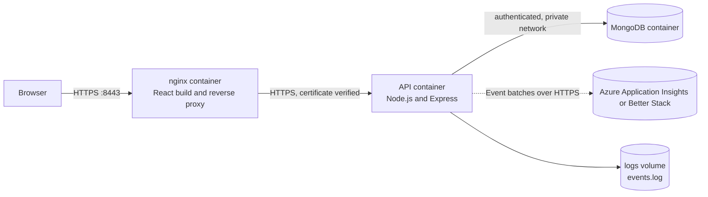
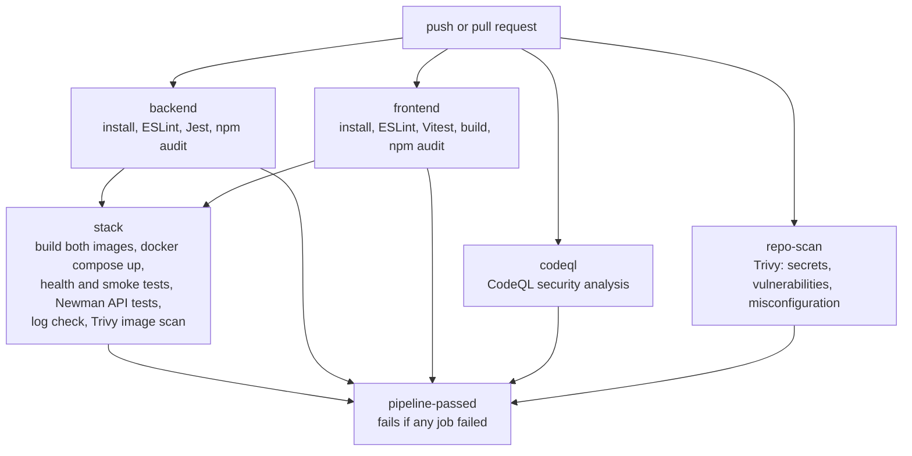

# HustleHub+ — Secure Freelance Marketplace

**INSY7314 · Portfolio of Evidence · Part 3: DevSecOps, Monitoring and Finalisation (Final PoE)**
Team: Quantum Coder · Last updated: 7 November 2026

HustleHub+ is a secure freelance marketplace. **Freelancers** advertise gigs, **clients** browse and book them, and every booking produces a **simulated-payment transaction** that feeds the freelancer's **income and estimated-tax dashboard**. An **administrator** can watch platform totals, accounts and security events. Security is built into every layer: authentication, role-based access, validation, sanitisation, rate limiting, security headers, HTTPS, account lockout, token revocation, structured logging and a configured pipeline for testing and scanning changes. The restored workflow still requires a verified GitHub Actions run on the final commit.

This final version builds on Part 1 (secure backend) and Part 2 (full-stack application) and adds what the Part 3 brief requires (IIE, 2026c): a tax and income dashboard with charts, a GitHub Actions CI/CD pipeline, static analysis, Docker and Docker Compose, cloud-ready logging and monitoring, additional security features, a final security review and complete documentation.

---

## Table of Contents

1. [Team](#1-team)
2. [Final PoE Requirements Traceability](#2-final-poe-requirements-traceability)
3. [Technology Stack](#3-technology-stack)
4. [Architecture](#4-architecture)
5. [Code Structure](#5-code-structure)
6. [Application Features](#6-application-features)
7. [Role-Based Access Control](#7-role-based-access-control)
8. [Tax Estimation and Income Dashboard](#8-tax-estimation-and-income-dashboard)
9. [Security Implementation](#9-security-implementation)
10. [Additional Security Features](#10-additional-security-features)
11. [Logging and Monitoring](#11-logging-and-monitoring)
12. [Running the Project](#12-running-the-project)
13. [Testing](#13-testing)
14. [CI/CD Pipeline](#14-cicd-pipeline)
15. [Static Code Analysis](#15-static-code-analysis)
16. [Docker and Docker Compose](#16-docker-and-docker-compose)
17. [API Reference](#17-api-reference)
18. [Final Security Review](#18-final-security-review)
19. [Demonstration Evidence](#19-demonstration-evidence)
20. [Known Limitations and Future Work](#20-known-limitations-and-future-work)
21. [Git Workflow and Collaboration](#21-git-workflow-and-collaboration)
22. [References](#22-references)

---

## 1. Team

| Name | Student Number | Main responsibility |
| --- | --- | --- |
| Blake Derek Godfrey | ST10435415 | Backend, auth and session, shared integration, income, security, final tests, README and evidence (with Hamza) |
| Syed Muhammad Hamza Kazmi | ST10443021 | Backend, JWT/auth middleware, environment config, rate limiting, shared integration, income, security, final tests, README and evidence (with Blake) |
| Connor Albertyn | ST10437293 | Frontend: `BrowseGigsPage.jsx` and `MyBookingsPage.jsx` (client browsing, booking confirmation, own bookings) |
| Muzammil Cassim | ST10259792 | Frontend: `MyGigsPage.jsx` and `ReceivedBookingsPage.jsx` (gig management, received bookings); backend error handling, HTTPS server and proxy configuration |

Per-file authorship from Parts 1 and 2 is recorded in header comments in the source. The shared component `frontend/src/components/BookingsPage.jsx` is used by both booking pages, so changes to it must be coordinated.

---

## 2. Final PoE Requirements Traceability

Every requirement and rubric criterion of the Part 3 brief (IIE, 2026c) maps to an implementation or evidence location below. Configuration is distinguished from observed execution: final CI, image-scan and live Newman evidence is still required.

| Requirement / rubric criterion | How it is met | Where to look |
| --- | --- | --- |
| **Final features: tax and income dashboard** | SARS 2026/27 tax estimate with a bracket-by-bracket breakdown, effective and marginal rate, income after tax, 12-month income bar chart, progress towards the tax threshold and a plain-language explanation | [Section 8](#8-tax-estimation-and-income-dashboard); `backend/src/services/incomeService.js`; `frontend/src/pages/DashboardPage.jsx`; `frontend/src/components/IncomeChart.jsx` |
| **CI/CD pipeline (backend and frontend)** | GitHub Actions: install, lint, test, audit, build both apps, CodeQL, Trivy, Docker Compose stack, Newman API tests, logging check; explicit Bash failure propagation is configured; actual final-run evidence remains pending | [Section 14](#14-cicd-pipeline); `.github/workflows/ci.yml` |
| **Static code analysis** | ESLint with `eslint-plugin-security` (backend and frontend, zero warnings allowed), CodeQL, Trivy, `npm audit`; results and fixes explained | [Section 15](#15-static-code-analysis); `docs/part3/STATIC_ANALYSIS.md`; `docs/part3/evidence/eslint-*.txt` |
| **Docker (backend and frontend)** | One Dockerfile in each of `backend/` and `frontend/`, orchestrated by `docker-compose.yml` with MongoDB; the workflow is configured to build, start and test both containers; final execution evidence remains pending | [Section 16](#16-docker-and-docker-compose); `backend/Dockerfile`; `frontend/Dockerfile`; `docker-compose.yml` |
| **Logging** | Structured events written to a file, container output and, when configured, Azure Application Insights or Better Stack; sensitive values are redacted | [Section 11](#11-logging-and-monitoring); `backend/src/utils/eventLogger.js`; `backend/src/utils/cloudLogger.js` |
| **Own security features (at least two)** | Account lockout, server-side token revocation (logout), and an admin security console; plus JWT algorithm pinning, request IDs, hardened containers and database authentication | [Section 10](#10-additional-security-features) |
| **Security review in README** | Threat-to-protection table with evidence for injection, XSS, authentication, access control and more | [Section 18](#18-final-security-review) |
| **README update** | This document: setup, features, security, testing, pipeline, logging, code structure, evidence | You are here |
| **GitHub** | Repository with branch-per-member workflow, pull requests and descriptive commits | [Section 21](#21-git-workflow-and-collaboration) |
| **Demonstration video** | Full flow: authentication, gig creation, booking, transaction, dashboard, admin | [Section 19](#19-demonstration-evidence) |

---

## 3. Technology Stack

| Layer | Technology |
| --- | --- |
| Frontend | React 19, React Router 7, Axios, Vite 8, plain SVG charts (no charting library) |
| Backend | Node.js 24 LTS (22.22.2 or later supported), Express 4, Mongoose 8, JSON Web Tokens, bcrypt |
| Database | MongoDB 7 (authenticated, private network) |
| Security middleware | Helmet (CSP and headers), express-rate-limit, express-validator, express-mongo-sanitize, xss-clean, CORS allow-list |
| Testing | Jest and Supertest (backend), Vitest and React Testing Library (frontend), Postman and Newman (API) (Jest, n.d.; Testing Library, n.d.; Vitest, n.d.; Postman, n.d.) |
| DevSecOps | GitHub Actions, ESLint with eslint-plugin-security, CodeQL, Trivy, npm audit, Dependabot (GitHub, n.d.a; ESLint, n.d.) |
| Containers | Docker and Docker Compose, nginx (unprivileged) as TLS front end (Docker, Inc., n.d.a) |
| Logging | Structured JSON, local file, container output, optional Azure Application Insights or Better Stack Logs |

---

## 4. Architecture



**Layered backend.** Each request passes through the same layers, so security checks cannot be skipped by one route:

`route → rate limiter → requireAuth (JWT) → requireRole (RBAC) → validators (validation and sanitisation) → controller → service (business rules, ownership) → repository (MongoDB) → error handler / event log`

**Networks.** Docker Compose defines two networks. `app-net` joins the web and API containers; `db-net` joins the API and MongoDB and is marked `internal`. The web container therefore cannot reach the database, MongoDB has no route to the internet, and no database port is published on the host.

---

## 5. Code Structure

```text
HustleHub/
├── .github/
│   ├── workflows/ci.yml            # CI/CD pipeline (lint, test, audit, CodeQL, Trivy, Docker stack, Newman)
│   └── dependabot.yml              # automatic dependency update pull requests
├── backend/                        # Node.js + Express API
│   ├── Dockerfile                  # multi-stage, non-root, health check
│   ├── eslint.config.js            # static analysis rules (security plugin)
│   ├── package.json
│   ├── postman/                    # Postman collections (Part 3 is the one Newman runs)
│   │   └── HustleHub_Part3.postman_collection.json
│   ├── scripts/
│   │   ├── generateCert.js         # local CA + HTTPS certificate (npm run gen-cert)
│   │   ├── trustCert.js            # trusts the local CA in the OS store (npm run trust-cert)
│   │   ├── runNewman.js            # runs the Postman collection (npm run test:api)
│   │   └── seedAdmin.js            # creates the administrator account (npm run seed-admin)
│   ├── src/
│   │   ├── server.js               # HTTPS server, graceful shutdown, log flush
│   │   ├── app.js                  # Express app, Helmet/CSP, CORS, sanitisation, limiters, routes
│   │   ├── config/
│   │   │   ├── env.js              # validated environment settings, tax brackets, lockout, logging
│   │   │   └── db.js               # MongoDB connection
│   │   ├── routes/                 # URL → middleware chain → controller
│   │   │   ├── authRoutes.js       # register, login, logout, profile
│   │   │   ├── gigRoutes.js        # browse, own gigs CRUD
│   │   │   ├── bookingRoutes.js    # create and list bookings
│   │   │   ├── incomeRoutes.js     # freelancer income summary
│   │   │   └── adminRoutes.js      # admin-only read views
│   │   ├── controllers/            # HTTP in/out, one file per area (thin)
│   │   ├── services/               # business rules
│   │   │   ├── authService.js      # hashing, JWT, lockout, logout
│   │   │   ├── gigService.js       # ownership checks
│   │   │   ├── bookingService.js   # booking + transaction creation
│   │   │   ├── incomeService.js    # income, SARS tax, breakdown, monthly series
│   │   │   └── adminService.js     # platform overview, user list, security events
│   │   ├── repositories/           # data access (MongoDB, with in-memory fallback for tests)
│   │   ├── schemas/                # Mongoose models (user, gig, booking, transaction)
│   │   ├── middleware/
│   │   │   ├── authMiddleware.js   # requireAuth (JWT + revocation), requireRole (RBAC)
│   │   │   ├── validators.js       # express-validator rules and field allow-lists
│   │   │   ├── rateLimiters.js     # global, auth and booking limiters (logged when exceeded)
│   │   │   └── errorHandler.js     # safe error responses + server_error log events
│   │   └── utils/
│   │       ├── eventLogger.js      # structured event log, redaction, request IDs
│   │       └── cloudLogger.js      # batched HTTPS delivery to the cloud log platform
│   └── tests/                      # Jest + Supertest (127 tests in 8 suites)
│       ├── api.test.js             # auth and API behaviour
│       ├── gigManagement.test.js   # gig CRUD, ownership, RBAC
│       ├── income.test.js          # income, tax brackets, breakdown, monthly series
│       ├── security.test.js        # injection, validation, headers, tampering
│       ├── securityFeatures.test.js# lockout, logout revocation, admin RBAC, JWT pinning
│       ├── injection.test.js       # NoSQL/script injection, prototype pollution, oversize bodies
│       └── logging.test.js         # events, redaction, request ID, cloud shipping
├── frontend/                       # React single-page app
│   ├── Dockerfile                  # build with Node, serve with unprivileged nginx
│   ├── nginx.conf                  # HTTPS, headers/CSP, /api reverse proxy, /healthz
│   ├── eslint.config.js            # static analysis rules (React + security)
│   └── src/
│       ├── App.jsx                 # routes and guards
│       ├── api/client.js           # Axios instance, token header, error messages
│       ├── context/AuthContext.jsx # session, login, register, server-side sign-out
│       ├── components/             # Navbar, ProtectedRoute, GigCard, AlertMessage, IncomeChart, BookingsPage
│       ├── pages/                  # Browse, Login, Register, MyGigs, MyBookings, ReceivedBookings, Dashboard, Admin
│       ├── lib/                    # validation.js, format.js (rand, chart helpers)
│       └── tests/                  # Vitest + React Testing Library (63 tests in 13 files)
├── docker-compose.yml              # MongoDB + API + web, networks, health checks
├── .env.example                    # settings for Docker Compose (copy to .env)
├── docs/
│   ├── part1/screenshots/          # Part 1 evidence
│   ├── part2/                      # Part 2 verification notes and screenshots
│   └── part3/
│       ├── STATIC_ANALYSIS.md      # findings, fixes and accepted risks
│       ├── EVIDENCE.md             # index of every piece of final-PoE evidence
│       └── evidence/               # saved test, lint, audit, Newman and logging outputs
├── CHANGELOG.md                    # what changed in each part
├── REFERENCES.md                   # IIE Harvard reference list
└── README.md
```

---

## 6. Application Features

| Area | What users can do |
| --- | --- |
| **Accounts** | Register as a client or freelancer, log in, log out (the server invalidates the token), view the verified profile. Passwords need 8 to 72 characters with a lowercase letter, an uppercase letter and a number. |
| **Gigs (freelancer)** | Create, edit and delete **own** gigs; activate or deactivate a listing. Nobody can change another freelancer's gig. |
| **Browsing (everyone)** | Browse active gigs and filter by category. |
| **Booking (client)** | Book a gig with a confirmation step. Payment is simulated; each booking creates a **transaction** linked to the client and the freelancer. The price comes from the saved gig, never from the request. |
| **Bookings** | Clients see their own bookings; freelancers see the bookings received on their gigs. |
| **Income dashboard (freelancer)** | Total income, tax-year income, estimated tax, effective and marginal rate, income after tax, a 12-month chart, tax threshold progress, a bracket breakdown, a "how is this calculated" explanation and recent payments. |
| **Admin console (admin)** | Platform totals (users, gigs, bookings, transaction value), the account list with locked accounts flagged, and recent authentication and security events. Read-only. |

**End-to-end flow.** Register → log in → freelancer creates a gig → client books it → a transaction is created → the freelancer's dashboard shows the income and tax → the admin sees the totals and the security log.

**Frontend routes**

| Route | Access | Screen |
| --- | --- | --- |
| `/` | Public | Browse gigs; clients see "Book this gig" and a confirmation dialog |
| `/login`, `/register` | Public | Authentication forms with client-side validation and server error display |
| `/my-gigs` | Freelancer | Create, edit and delete own gigs |
| `/received-bookings` | Freelancer | Bookings received on own gigs |
| `/dashboard` | Freelancer | Income, tax estimate and charts |
| `/my-bookings` | Client | Own booking history |
| `/admin` | Admin | Admin console |
| `/404`, `*` | Public | Not-found page |

**Security and UX behaviour**

- The session is verified with `/api/auth/profile` after every reload, the user is logged out at the expiry time supplied by the backend, and a 401 on any protected call clears the session.
- Forms reject invalid input before sending (email, password rules, gig length and price) and show readable server error messages. Tokens, stack traces and hashes are never displayed.
- Mutation buttons are disabled while a request is pending, which prevents duplicate bookings.
- All API values are rendered as React text, never as HTML, and `react/no-danger` is enforced by the linter (React, n.d.).
- The token is kept in `localStorage` to keep the session design simple. That makes safe rendering, sanitisation and the strict Content Security Policy especially important, and it is listed under limitations.

---

## 7. Role-Based Access Control

Access is enforced **on the server** by `requireAuth` then `requireRole(...)`. The frontend `ProtectedRoute` only improves the user experience; it is never the security boundary (OWASP, 2021; OWASP, 2024i).

| Capability | Client | Freelancer | Admin |
| --- | :---: | :---: | :---: |
| Browse active public gigs | ✅ | ✅ | ✅ |
| Read own verified profile / log out | ✅ | ✅ | ✅ |
| Create / edit / delete **own** gigs | ❌ | ✅ | ❌ |
| Create and view **own** bookings | ✅ | ❌ | ❌ |
| View received bookings and own income and tax | ❌ | ✅ | ❌ |
| Platform overview, account list, security events | ❌ | ❌ | ✅ |

**Ownership and object-level checks**

- `gigService.assertOwnership` runs on every update and delete; another freelancer's request returns **403**.
- A booking accepts only a `gigId`. The client, freelancer and price are taken from the verified token and the saved gig.
- Gig updates cannot change `freelancerId`, IDs or other protected fields; unknown fields are rejected with **400**.
- A user cannot book their own gig.
- Lists (`/bookings/mine`, `/bookings/received`, `/gigs/mine`, `/income/summary`) are always scoped to the authenticated user.
- The server reloads the user on every protected request to obtain the trusted role, so a stale or forged role claim in a token is ignored.
- Refused requests are logged as `access_denied` events with the user, role and path.

**Admin role.** Public sign-up cannot create admins (the `role` field accepts only `client` or `freelancer`). The first administrator is created from the command line by someone with server access (`npm run seed-admin`, see [Section 12](#12-running-the-project)). Admin endpoints are read-only and never return password hashes or security counters.

---

## 8. Tax Estimation and Income Dashboard

The estimate is calculated by `backend/src/services/incomeService.js` from the freelancer's own transactions only (SARS, 2026).

### 8.1 The calculation, step by step

1. **Tax year.** South African tax years run from **1 March to the end of February**. The service finds the tax year for today's date using South African time (UTC+2) and adds up every simulated booking payment in that year. This is the *tax-year income*.
2. **Brackets.** The 2026/27 individual brackets are applied. Each slice of income is taxed at its own rate:

   | Taxable income (R) | Rate | Cumulative tax at start of bracket (R) |
   | --- | ---: | ---: |
   | 0 – 245 100 | 18% | 0 |
   | 245 101 – 383 100 | 26% | 44 118 |
   | 383 101 – 530 200 | 31% | 79 998 |
   | 530 201 – 695 800 | 36% | 125 599 |
   | 695 801 – 887 000 | 39% | 185 215 |
   | 887 001 – 1 878 600 | 41% | 259 783 |
   | Above 1 878 600 | 45% | 666 339 |

3. **Rebate.** The primary rebate of **R17 820** is subtracted from the tax. Tax cannot go below R0.
4. **Threshold.** Because R17 820 ÷ 18% = R99 000, a freelancer earning up to **R99 000** in a tax year has an estimated tax of **R0**. The dashboard shows how far along that threshold they are.
5. **Rates.** *Effective rate* = estimated tax ÷ tax-year income. *Marginal rate* = the rate that applies to the next rand earned.
6. **Income after tax** = tax-year income − estimated tax.

### 8.2 Worked examples

| Tax-year income | Tax before rebate | Rebate | **Estimated tax** | Effective rate | Income after tax |
| ---: | ---: | ---: | ---: | ---: | ---: |
| R10 500 | R1 890 | −R17 820 | **R0** | 0% | R10 500 |
| R150 000 | R27 000 | −R17 820 | **R9 180** | 6.12% | R140 820 |
| R300 000 | R44 118 + 26% × R54 900 = R58 392 | −R17 820 | **R40 572** | 13.52% | R259 428 |

The unit tests check these figures and that the per-bracket amounts shown on the dashboard always add up to exactly the same value as the headline estimate (`backend/tests/income.test.js`).

### 8.3 What the dashboard shows

| Element | Purpose |
| --- | --- |
| Summary cards | Total income, estimated annual tax (with effective and marginal rate) and income after tax |
| **Bar chart** | Income per month for the last 12 months, drawn as accessible SVG with a "view as table" option |
| **Progress bar** | Tax-year income as a percentage of the R99 000 threshold |
| **Bracket table** | Each band, its rate, the income in it and the tax, then the rebate and the final estimate |
| "How is this calculated?" | The steps above in plain language, so a R0 estimate is explained rather than looking like a bug |
| Recent payments | The five newest transactions |

The estimate is for guidance only and says so on screen: it uses marketplace income only and is not professional tax advice. All amounts are in South African rand (ZAR).

---

## 9. Security Implementation

Security controls from Parts 1 and 2 are all still in place and tested. This is the summary; the full threat mapping is in [Section 18](#18-final-security-review).

| Control | Implementation |
| --- | --- |
| **Password storage** | bcrypt with 12 salt rounds; length capped at 72 bytes (bcrypt's limit) (OWASP, 2024a) |
| **JWT** | HS256 signed, issuer checked, 1-hour expiry, **algorithm pinned**, user reloaded on every request, version checked for revocation (Jones, Bradley and Sakimura, 2015) |
| **Validation** | `express-validator` on every body and query; field allow-lists reject unknown fields; IDs must be valid (OWASP, 2024b) |
| **Sanitisation** | `express-mongo-sanitize` removes `$` and `.` operator keys; `xss-clean` strips script payloads; the 10 kb body limit stops oversized payloads; React escapes all output (OWASP, 2024g; OWASP, 2024h) |
| **Rate limiting** | Global 300 requests, authentication 20 and booking 10 per 15 minutes per IP; JSON 429 responses; each rejection is logged |
| **Security headers** | Helmet: HSTS, `nosniff`, frame blocking and a Content Security Policy that allows only same-origin resources (`default-src 'self'`, `object-src 'none'`, `frame-ancestors 'none'`); the nginx front end adds the same document-level headers (Mozilla, 2026b) |
| **HTTPS** | TLS 1.2 and 1.3; the nginx proxy verifies the API certificate against the local CA (Mozilla, 2026a; nginx, n.d.) |
| **CORS** | Explicit origin allow-list, never a wildcard |
| **Safe errors** | Clients receive generic messages; details and the request ID go to the log only |
| **Secrets** | `.env`, certificates and keys are git-ignored; the app refuses to start with a short or placeholder JWT secret; CI creates throw-away secrets for each run |

---

## 10. Additional Security Features

The brief asks for at least two features beyond the minimum (IIE, 2026c). Three are fully functional and tested, plus smaller hardening measures.

### 10.1 Account lockout (brute-force protection per account)

- **Problem.** IP rate limiting alone does not stop an attacker who spreads password guesses across many addresses against one account (OWASP, 2024c).
- **Behaviour.** After **5** consecutive failed sign-ins an account is locked for **15 minutes** (`LOCKOUT_MAX_ATTEMPTS`, `LOCKOUT_MINUTES`). While locked, the password is **not checked**, so a correct guess cannot unlock the account early; the API answers **429** with a `Retry-After` header. A successful sign-in resets the counter (Grassi et al., 2017).
- **Integration.** Counters live on the user record (atomic `$inc` in MongoDB), events `login_failed`, `login_blocked` and `account_locked` are logged, the admin console shows locked accounts, and the counters are never returned by any API.
- **Trade-off.** The lock message confirms that an account exists, but only after repeated failures against it; normal failures still use the same generic message for unknown emails and wrong passwords.
- **Tests.** `backend/tests/securityFeatures.test.js` (locks after the limit, other accounts unaffected, counter reset, lock expiry, no data leakage) and the Newman group "Part 3 Security Features".

### 10.2 Server-side logout with token revocation

- **Problem.** A JWT normally stays valid until it expires, so a stolen token still works after the user "logs out" (OWASP, 2024e).
- **Behaviour.** Every token carries a version (`tv`). `POST /api/auth/logout` raises the user's stored `tokenVersion`, so **every** token issued earlier is rejected with 401 even though its signature is still valid. A new login receives a token with the new version. The React app calls the endpoint when the user clicks "Log out" and clears the local session even if the server cannot be reached.
- **Integration.** Checked in `requireAuth` on every protected request; rejected tokens are logged as `token_rejected` (reason `revoked`).
- **Tests.** Token works before logout, is refused after, a new login works, other users are unaffected; frontend test for the sign-out flow.

### 10.3 Admin security console and audit view

- **Problem.** Without a monitoring view, an administrator has to read raw log files to notice an attack.
- **Behaviour.** `GET /api/admin/overview`, `/users` and `/security-events` (admin only) provide platform totals, accounts with a locked flag and the newest authentication and security events. The React page `/admin` presents them. Everything is read-only and shows no secrets.
- **Integration.** Uses the same event log as [Section 11](#11-logging-and-monitoring); every admin read is itself logged as `admin_access`.
- **Tests.** 401 without a token, 403 for clients and freelancers, data shape, no hashes or counters, limit validation, and frontend tests for access control and rendering.

### 10.4 Smaller hardening measures

| Measure | Detail |
| --- | --- |
| JWT algorithm pinning | Only HS256 is accepted; `alg: none` and other HMAC variants are refused (tested) |
| Request IDs | Every response carries `X-Request-Id`; the same ID is in the log, so a user's error can be traced |
| Log redaction | Passwords, tokens, hashes and credentials in connection strings are never written to a log (tested) |
| Hardened containers | Non-root users, no Linux capabilities for the API, `no-new-privileges`, health checks, read-only certificate mounts |
| Authenticated database | MongoDB requires a password, is on an internal network and has no published port |
| Supply chain | Dependabot, `npm audit` gate, Trivy and CodeQL in the pipeline |

---

## 11. Logging and Monitoring

### 11.1 What is logged, and why

Logging answers *who did what, when, from where, and did it work*. That is what is needed to detect attacks, investigate incidents and prove what happened (OWASP, 2024d).

| Event | Level | Category | Logged when | Why it matters |
| --- | --- | --- | --- | --- |
| `user_registered` | info | auth | An account is created | Tracks account growth and spots mass sign-up abuse |
| `user_login` | info | auth | Successful sign-in | Establishes normal behaviour and who was active |
| `login_failed` | warn | auth | Wrong password or unknown email | Repeated failures are the signature of password guessing and credential stuffing |
| `login_blocked` | warn | auth | Sign-in attempt on a locked account | Shows an attack still in progress |
| `account_locked` | warn | security | Failure limit reached | A direct brute-force alarm |
| `user_logout` | info | auth | Token revoked | Lets an investigation separate a user's sessions |
| `token_rejected` | warn | security | Missing, invalid, expired or revoked token | Reveals forged or stolen token use |
| `access_denied` | warn | security | A role was not allowed on an endpoint | Shows privilege-escalation attempts (a client calling freelancer or admin routes) |
| `rate_limit_exceeded` | warn | security | A limiter rejected a request | Shows scraping, flooding or brute force |
| `booking_created` | info | booking | A booking is saved | Business audit trail |
| `transaction_created` | info | transaction | The simulated payment record is saved (amount, users) | Financial audit trail; allows reconciliation |
| `gig_created`, `gig_updated`, `gig_deleted` | info | gig | Gig changes | Shows who changed a listing |
| `admin_access` | info | security | An admin reads a console view | Audits the audit view |
| `server_error` | **error** | system | Any HTTP 5xx | Operational alarm, linked to the user's request by `requestId` |
| `booking_cleanup_failed` | **error** | system | A compensating clean-up failed | Flags possible inconsistent data |
| `server_started`, `server_stopping` | info | system | Process lifecycle | Explains gaps and restarts |
| `http_request` | info | http | Completed requests to `/api/auth`, `/api/bookings`, `/api/admin` | Method, path, status, duration, IP and user |

A saved sample covering these events from a real run is in `docs/part3/evidence/logging-sample.jsonl`.

### 11.2 Format and safety

Each event is one JSON line, for example:

```json
{"timestamp":"2026-10-30T09:14:02.511Z","level":"warn","category":"security","event":"account_locked","userId":"66f1...","lockMinutes":15,"ip":"203.0.113.7","requestId":"3d092f65-2689-40a1-afdf-9ab206cce9f2"}
```

- **No sensitive data.** Fields named like passwords, tokens, secrets, hashes or credentials are replaced with `[REDACTED]`, credentials inside connection strings are masked, long values are truncated and nested objects are not logged. Tests prove that a password passed by mistake never reaches the log file or the cloud payload.
- **Log injection.** Entries are JSON-encoded, so line breaks in user-supplied text cannot forge extra log lines.
- **Personal information.** Email addresses and IP addresses appear only in authentication events, which is needed for security monitoring. Logs should be kept only as long as needed and protected like other personal data under South Africa's POPIA.

### 11.3 Where the logs go

| Destination | Purpose |
| --- | --- |
| `backend/logs/events.log` (Docker volume `backend-logs`) | Local searchable file, rotated at 5 MB; read by the admin console |
| Container output | In production each event is also written to standard output, so `docker compose logs backend` shows it and container platforms collect it (Wiggins, 2017) |
| **Cloud log platform (Azure Application Insights or Better Stack)** | An independent managed copy that survives container replacement and supports search, dashboards and alerts. Protect cloud access separately; this setup does not claim immutable storage. |

Cloud delivery is implemented in `backend/src/utils/cloudLogger.js`: entries are batched (20 per request or after a 5-second timer), sent over **HTTPS only**, held in a bounded in-memory buffer if the service is unreachable, retried, and flushed during shutdown within the server's exit deadline. Azure uses the full resource connection string and its regional ingestion endpoint; Better Stack uses a bearer source token. Delivery runs outside user requests. This is best-effort delivery: the queue holds at most 1,000 events, drops the oldest on overflow and is lost on a forced process exit. A network failure after Azure accepts a batch can produce duplicates on retry.

### 11.4 Connecting cloud logging

#### Azure Application Insights (current setup)

The Azure resource is `hustlehub-logs`, in `rg-hustlehub-poe`, South Africa North. Supplied screenshots from 5 November show actual Azure delivery: [booking/transaction/login events](docs/part3/screenshots/Logging1.png) and [failed login/logout events](docs/part3/screenshots/Logging2.png). These are dated original-system observations; recheck delivery after the final repository deployment using the steps below.

1. Copy the **full Connection string** from the resource's Overview into the **root `.env`** for Docker (or `backend/.env` for direct `npm start`):

   ```dotenv
   APPLICATIONINSIGHTS_CONNECTION_STRING="<full connection string copied locally from Azure>"
   ```

2. Keep the real `.env` out of Git and screenshots. Leave `LOG_CLOUD_URL` and `LOG_CLOUD_TOKEN` empty for this setup. The Azure setting takes precedence when supplied; an incomplete Azure value disables shipping rather than falling back to another service.
3. Run `docker compose up --build -d backend`, then `docker compose restart frontend`. Keep the existing database password, JWT secret, certificates and named volumes.
4. Confirm the new `server_started` entry shows `cloudLogging: true`. This proves configuration only. Log in, fail one login, create a gig and book it with a client.
5. Open the Application Insights resource's **Logs**, use KQL mode if prompted, and run:

   ```kusto
   customEvents
   | where timestamp > ago(24h)
   | where cloud_RoleName == "hustlehub-backend"
   | project timestamp, name, category=tostring(customDimensions.category), level=tostring(customDimensions.level), requestId=tostring(customDimensions.requestId), bookingId=tostring(customDimensions.bookingId), transactionId=tostring(customDimensions.transactionId), amount=tostring(customDimensions.amount)
   | order by timestamp desc
   | take 50
   ```

6. Allow a few minutes for initial ingestion. Save a screenshot of actual returned events in `docs/part3/screenshots/` and record the tested commit/date. Do not claim live delivery based only on unit tests or the startup flag.

The adapter sends only the existing redacted events as **customEvents** with details in **customDimensions**. It does not enable automatic request tracing or Live Metrics. See [Azure logging setup and verification](docs/part3/AZURE_LOGGING.md) for the workspace-table query, failure checks, limitations and evidence checklist. The regional ingestion endpoint and connection-string format follow Microsoft's documentation (Microsoft, n.d.a; Microsoft, n.d.b).

#### Better Stack (alternative, not required for Azure)

1. Create a free account at Better Stack and add a **Logs source** of type **HTTP**.
2. Copy the source's **ingesting host** URL and **source token**.
3. Put them in the root `.env` (never commit this file):

   ```bash
   LOG_CLOUD_URL=https://<your-ingesting-host>
   LOG_CLOUD_TOKEN=<your-source-token>
   ```

4. Start the stack with `docker compose up --build`. The API logs `server_started` with `cloudLogging: true`.
5. Use the application (log in, fail a login, book a gig) and open **Live tail** in Better Stack. The cloud payload uses `message` for the event name; search for `login_failed` or filter on the `category` field.
6. Suggested alerts: more than 10 `login_failed` events in 5 minutes; any `account_locked`; any `level:error`; any `rate_limit_exceeded` burst.

If neither provider is configured, cloud shipping is off and the file and container logs still work. Azure takes precedence when its connection string is supplied.

### 11.5 Reading the logs

```bash
docker compose logs -f backend                       # live container output (JSON lines)
docker compose exec backend tail -n 50 logs/events.log
```

The admin console (`/admin`) shows the newest authentication and security events without shell access.

---

## 12. Running the Project

### Prerequisites

Node.js 22.22.2 or later (Node 24 is used in Docker and CI), npm, Docker Desktop with Docker Compose v2 (for the container stack) and OpenSSL. Commands are shown for **Windows PowerShell** where they differ; on macOS and Linux use `npm` and the Bash forms.

### Option A: Docker Compose (recommended — runs the whole stack)

```powershell
# 1. Create the local HTTPS certificate (mounted read-only into the containers)
node backend/scripts/generateCert.js
#    macOS/Linux only: make the key readable by the non-root container users
#    chmod 644 backend/certs/*.pem

# 2. Create the settings file and fill in two secrets
if (-not (Test-Path .env)) { Copy-Item .env.example .env }
# Preserve an existing .env; fill only missing settings locally.
#    JWT_SECRET     : node -e "console.log(require('crypto').randomBytes(32).toString('hex'))"
#    MONGO_PASSWORD : node -e "console.log(require('crypto').randomBytes(24).toString('hex'))"

# 3. For existing data, read docs/part3/FINAL_VERIFICATION.md first.
# On a fresh configured installation, build and start the stack:
docker compose up --build -d --wait --wait-timeout 180
docker compose ps                    # all three services should be running; mongo and backend "healthy"

# 4. Create the administrator account (choose your own email and password)
docker compose exec -e ADMIN_EMAIL=admin@example.com -e ADMIN_PASSWORD="Choose-A-Str0ng-Password" backend node scripts/seedAdmin.js
```

Open **https://localhost:8443**. To remove the browser's "Not secure" warning, trust the local certificate authority once:

```powershell
cd backend; npm ci; npm run trust-cert; cd ..   # Windows asks you to confirm; then fully restart the browser
```

Firefox uses its own store: enable `security.enterprise_roots.enabled` in `about:config`, or import `backend/certs/rootCA.pem`. Undo with `npm run trust-cert -- --remove`.

```powershell
docker compose logs -f backend       # watch the structured log events
docker compose down                  # stop, keep the database
```

**Troubleshooting**

| Symptom | Fix |
| --- | --- |
| `MONGO_PASSWORD` or `JWT_SECRET` "is required" | Fill both in the root `.env` (step 2) |
| API cannot read `key.pem` (Linux/macOS) | `chmod 644 backend/certs/*.pem` |
| MongoDB "Authentication failed" after changing the password | Existing volumes retain their users/passwords. Preserve the original credentials and data; use a separate project for fresh verification, then back up/migrate existing data deliberately. See FINAL_VERIFICATION.md. |
| Port 8443 or 8080 already in use | Stop the other program or change the `ports` entry in `docker-compose.yml` |
| Admin login does nothing | Run the `seedAdmin` command in step 4 (sign-up cannot create admins) |

### Option B: Run locally without Docker

```powershell
# Backend
cd backend
npm ci
if (-not (Test-Path .env)) { Copy-Item .env.example .env }
#  edit .env: set JWT_SECRET (32+ random characters) and MONGODB_URI (default mongodb://localhost:27017/hustlehub)
npm run gen-cert          # creates certs/rootCA.pem, cert.pem, key.pem
npm run trust-cert        # optional: remove the browser warning
npm run seed-admin        # optional: needs ADMIN_EMAIL and ADMIN_PASSWORD set in the environment

# Frontend (production build served by the API)
cd ../frontend
npm ci
npm run build

# Start
cd ../backend
npm start                 # open https://localhost:5443
```

**Frontend development mode:** run `npm run dev` in `frontend/` and open `https://localhost:5173`. Vite uses the same certificate and proxies `/api` to the backend. Keep `TRUST_PROXY=false` for direct local runs.

### Environment variables

| Variable | Purpose | Default / example |
| --- | --- | --- |
| `PORT` | API HTTPS port | `5443` |
| `NODE_ENV` | `development`, `production` or `test` | `development` |
| `JWT_SECRET` | Token signing secret (at least 32 characters, required) | none |
| `JWT_EXPIRES_IN` | Token lifetime | `1h` |
| `SSL_KEY_PATH`, `SSL_CERT_PATH` | HTTPS key and certificate | `./certs/key.pem`, `./certs/cert.pem` |
| `BCRYPT_SALT_ROUNDS` | bcrypt work factor | `12` |
| `MONGODB_URI` | MongoDB connection (required outside tests) | `mongodb://localhost:27017/hustlehub` |
| `CORS_ORIGINS` | Comma-separated allowed origins | `https://localhost:5173,https://localhost:5443` |
| `BOOKING_RATE_LIMIT_WINDOW_MS`, `BOOKING_RATE_LIMIT_MAX` | Booking limiter | `900000`, `10` |
| `TRUST_PROXY` | `1` only behind the controlled nginx proxy | `false` |
| `LOCKOUT_MAX_ATTEMPTS`, `LOCKOUT_MINUTES` | Account lockout | `5`, `15` |
| `LOG_CLOUD_URL`, `LOG_CLOUD_TOKEN` | Cloud log shipping (both needed, URL must be `https://`) | empty (off) |
| `APPLICATIONINSIGHTS_CONNECTION_STRING` | Full Azure connection string; requires InstrumentationKey and HTTPS IngestionEndpoint; takes precedence over the HTTP provider | empty (off) |
| `LOG_DIR` | Where `events.log` is written | `backend/logs` |
| `ADMIN_EMAIL`, `ADMIN_PASSWORD` | Used only by `seedAdmin.js` and the Newman admin checks | none |
| `MONGO_PASSWORD` | MongoDB password in Docker Compose (root `.env`) | none |

Never commit `.env` files, certificates or private keys.

---

## 13. Testing

### 13.1 Backend: Jest and Supertest — 127 tests in 8 suites

```bash
cd backend
npm test            # runs Jest in NODE_ENV=test with in-memory repositories
npm run lint        # static analysis (see Section 15)
```

| Suite | Covers |
| --- | --- |
| `api.test.js` | Registration, login, profile, validation, error format |
| `gigManagement.test.js` | Gig create/read/update/delete, RBAC and ownership |
| `income.test.js` | Income totals, SARS brackets, threshold, tax year, **bracket breakdown, monthly series, marginal rate** |
| `security.test.js` | Admin sign-up blocked, tampering, JWT rejection, safe errors, trust-proxy default |
| `securityFeatures.test.js` | **Account lockout, logout revocation, admin RBAC and data hiding, JWT algorithm pinning** |
| `injection.test.js` | **NoSQL operator injection, script injection, prototype pollution, oversized bodies, mass assignment** |
| `logging.test.js` | **Events for logins, bookings, transactions and errors; redaction; request IDs; cloud shipping and retry** |
| `azureLogging.test.js` | Azure payload mapping, configuration, batching, retry and redaction with mocked HTTP |

### 13.2 API: Postman and Newman — 55 request definitions; final live run pending

```bash
cd backend
# the API must be running (for example the Docker Compose stack)
NEWMAN_BASE_URL=https://localhost:8443 ADMIN_EMAIL=admin@example.com ADMIN_PASSWORD='...' npm run test:api
```

`backend/postman/HustleHub_Part3.postman_collection.json` is organised into groups with explicit success and failure cases:

1. **Auth setup** — register, login, duplicate and wrong-password rejection, missing and invalid JWT.
2. **Gig management** — RBAC and ownership (403), invalid input (400), tampering rejected.
3. **Bookings and transactions** — booking creates a transaction, price tampering rejected, RBAC.
4. **Income tracking** — correct figures, clients blocked.
5. **Gig deletion** — ownership, history survives deletion.
6. **Part 3 security features** — client/freelancer blocked from admin, dashboard analytics fields, **lockout (5 failures then 429 with `Retry-After`)**, **logout revokes the token**, admin overview/users/security events (skipped automatically when no admin credentials are supplied).
7. **Rate limiting** — booking and login limiters must reach **429**.
8. **API headers** — CSP, `nosniff` and request ID present.

Use isolated test data; see [final verification steps](docs/part3/FINAL_VERIFICATION.md). The rate-limit probes deliberately use up the per-IP budgets, so wait 15 minutes or restart the API before another run. Newman writes `test-results/newman-summary.json` (counts and failures, no tokens) and `test-results/newman-junit.xml`, and exits non-zero on any failure, which fails the pipeline.

### 13.3 Frontend: Vitest and React Testing Library — 63 tests in 13 files

```bash
cd frontend
npm test
```

Tests cover rendering and user interaction: login and registration forms, gig creation, editing and deletion with confirmation, booking, the dashboard (cards, **chart, bracket table, progress bar, methodology, hostile text rendered as plain text**), the **income chart component and formatting helpers**, the **admin console and route guard**, and the **server-side sign-out flow**. The API client is mocked, so no server is needed. Four additional booking-display/recovery test files are included in the repository and preserved in this patch.

### 13.4 Dated verification results

The supplied repository was checked in an isolated Linux audit workspace on **7 November 2026**. The patch changes configuration, documentation and evidence only; application source and the four additional team test files are retained.

| Check | Observed result | Evidence |
| --- | --- | --- |
| Backend Jest | **127 passed**, 8 suites; in-memory repositories and mocked cloud HTTP | [Backend output](docs/part3/evidence/review-2026-11-07/backend-tests.txt) |
| Frontend Vitest | **63 passed**, 13 files; mocked API components | [Frontend output](docs/part3/evidence/review-2026-11-07/frontend-tests.txt) |
| Backend / frontend ESLint | Exit 0; zero warnings allowed | [Backend](docs/part3/evidence/review-2026-11-07/eslint-backend.txt), [frontend](docs/part3/evidence/review-2026-11-07/eslint-frontend.txt) |
| Production dependency audits | **0 reported vulnerabilities** in both projects | [Backend](docs/part3/evidence/review-2026-11-07/npm-audit-backend.txt), [frontend](docs/part3/evidence/review-2026-11-07/npm-audit-frontend.txt) |
| Frontend production build | Passed | [Build output](docs/part3/evidence/review-2026-11-07/frontend-build.txt) |
| Live Newman, final Docker stack, CodeQL and Trivy | **Not run in this audit workspace** | Complete on the actual final commit and retain the results |

The older October Newman output (67 executions / 90 assertions) is historical, not a new final-stack result. The collection contains 55 request definitions and deliberately repeats lockout/rate-limit probes; execution counts can also depend on whether admin checks are enabled.

The evidence directory contains dated local-review outputs. GitHub Actions artifacts and final commit identity must be added after the actual run. See [the evidence index](docs/part3/EVIDENCE.md).

---

## 14. CI/CD Pipeline

The pipeline is defined in `.github/workflows/ci.yml` and is configured to run on pushes to `main`, `master`, `blake`, `hamza`, `connor` and `muzzi`, on pull requests and on demand (GitHub, n.d.a).



| Job | What it does | Fails when |
| --- | --- | --- |
| **backend** | `npm ci`, ESLint with security rules (`--max-warnings 0`), Jest tests, production `npm audit` | A lint warning, a failing test or a high/critical vulnerability |
| **frontend** | `npm ci`, ESLint, Vitest, **production build**, production `npm audit` | Same, or the build breaks |
| **codeql** | GitHub CodeQL with the `security-extended` query set for JavaScript (GitHub, n.d.c) | CodeQL cannot run; findings appear in the Security tab |
| **repo-scan** | Trivy scans the repository for committed secrets, fixable HIGH/CRITICAL vulnerabilities and Dockerfile misconfiguration (Aqua Security, n.d.) | Any such finding |
| **stack** | Creates a throw-away certificate and secrets, **builds both Docker images**, starts MongoDB, API and web with Docker Compose, waits for health, **checks all three containers are running**, smoke-tests the web app, API and security headers, creates the admin account, runs **Newman against the running containers**, checks that the key log events appeared in the container log and that no secret did, then scans both images with Trivy | A container does not become healthy, any API assertion fails, a log event is missing or a secret leaks, or an image has a fixable CRITICAL vulnerability |
| **pipeline-passed** | Collects every job result | Any job failed, was cancelled or was skipped |

**Security tests in the pipeline:** ESLint security rules, CodeQL, Trivy (repository and both images), `npm audit`, the 11 injection and 3 JWT attack tests in Jest, the Newman RBAC, ownership, lockout, revocation and rate-limit checks, and the logging leak check.

**Evidence configured as artifacts** on each run: backend/frontend test output, production audit output, frontend build output, lint reports, full `npm audit` reports, Newman JUnit and summary, container logs, `docker compose ps` and Trivy reports.

**Making failures block merging.** In the repository settings, add a branch protection rule for `main` that requires the **Pipeline result** check, so a red pipeline cannot be merged. Dependabot (`.github/dependabot.yml`) opens weekly pull requests for npm, Docker and Actions updates, which the pipeline then tests (GitHub, n.d.b).

**Repository visibility.** CodeQL results in the Security tab need a public repository or GitHub Advanced Security.

---

## 15. Static Code Analysis

Static analysis reads the source without running it to find bugs and risky patterns early (ESLint, n.d.). Four tools are used, each looking for something different.

| Tool | Scope | Looks for |
| --- | --- | --- |
| **ESLint** + `eslint-plugin-security` (backend) | API source and scripts | `eval`, unsafe regular expressions (ReDoS), non-literal file paths, object-injection sinks, child-process use, unused code (eslint-community, n.d.) |
| **ESLint** + React, React Hooks and security rules (frontend) | React source | `dangerouslySetInnerHTML` (blocked by `react/no-danger`), hook mistakes, unescaped entities, the same security patterns |
| **CodeQL** | Whole repository | Data-flow vulnerabilities such as injection, XSS, path traversal and weak crypto (GitHub, n.d.c) |
| **Trivy** and **npm audit** | Dependencies, secrets, Dockerfiles, images | Known vulnerable packages, committed secrets, insecure container configuration (npm, n.d.) |

### Results (ESLint, final run)

| | Backend | Frontend |
| --- | --- | --- |
| Errors | **0** | **0** |
| Warnings | **0** (`--max-warnings 0`) | **0** |

The first run found **30 warnings** in the backend and **1 error** in the frontend. The workflow is configured to reject any new warning; final-run evidence remains pending. `npm audit` initially found **3 vulnerable packages in the backend's production dependencies** (1 high, 2 moderate). Raw outputs are in `docs/part3/evidence/`, and the full explanation is in [`docs/part3/STATIC_ANALYSIS.md`](docs/part3/STATIC_ANALYSIS.md).

### What the results indicate and the fixes applied

| Finding | What it meant | Fix |
| --- | --- | --- |
| `detect-unsafe-regex` in `validators.js` | The ID pattern used a repeated group `(?:-[a-f0-9]{4}){3}`, which the rule treats as a possible catastrophic-backtracking (ReDoS) pattern | Rewritten as four explicit fixed-length groups. Same matches, no repetition operator on a group |
| `detect-object-injection` ×5 in `eventLogger.js` | Writing `safe[key] = value` and reading `MAP[eventType]` with a dynamic key can let a key such as `__proto__` or `constructor` change an object's prototype | Lookup table became a `Map`; the redaction step now builds its result with `Object.fromEntries`, which creates plain own properties |
| `detect-object-injection` in `env.js` | `process.env[key]` inside the start-up check | Reviewed: keys come from a fixed list, not input. Documented with a targeted `eslint-disable-next-line` and the reason |
| `detect-non-literal-fs-filename` ×11 in shipped code (`server.js`, `eventLogger.js`, `generateCert.js`) | File paths built from variables | Reviewed: the paths come from operator-set configuration (`LOG_DIR`, certificate paths) or fixed names, never from a request. Documented with a file-level directive that states the reason |
| Test-file warnings | The same rules fire on test fixtures that are never shipped | Injection rules switched off for `tests/` in the config, with the reason beside it |
| Stale `eslint-disable` comments | Left over from earlier versions | Removed |
| `react/no-unescaped-entities` in `LoginPage.jsx` | A raw apostrophe in JSX text | Replaced with `&apos;` |
| `npm audit`: `body-parser`, `qs`, `ip-address` (backend) | Known denial-of-service issues in transitive production dependencies | Earlier fixes updated them within allowed versions; the 7 November review passed all 127 backend tests and reported zero production dependency vulnerabilities |

**Accepted and documented risk.** `npm audit` still lists advisories in **Newman's own dependencies** (a development-only test tool). The only automatic fix would downgrade Newman to version 4 (a breaking change to an older release). Newman is not installed in the production image (`npm ci --omit=dev`), it only runs our own collection in CI, and the pipeline gates on production dependencies while publishing the full report as an artifact.

**Reading CodeQL results.** After the first pipeline run, open **Security → Code scanning** in GitHub. Any alert listed there should be fixed or dismissed with a written reason before final submission.

---

## 16. Docker and Docker Compose

| File | Purpose |
| --- | --- |
| `backend/Dockerfile` | API image: multi-stage build, production dependencies only, runs as the `node` user, health check on `/health` |
| `frontend/Dockerfile` | Web image: builds the React app with Node, serves it with **unprivileged nginx** (non-root), health check on `/healthz` |
| `docker-compose.yml` | Orchestrates `mongo`, `backend` and `frontend` with networks, volumes, health checks and start-up order |
| `.env.example` | Settings template for Compose (secrets are never in the repository) |
| `backend/.dockerignore`, `frontend/.dockerignore` | Keep `.env` files, keys, tests and `node_modules` out of the images |

**Service layout**

| Service | Image | Network | Published port | Notes |
| --- | --- | --- | --- | --- |
| `mongo` | `mongo:7` | `db-net` (internal) | **none** | Password required; data in volume `mongo-data`; health check with an authenticated ping |
| `backend` | `hustlehub/backend:local` | `db-net`, `app-net` | **none** (nginx proxies to it) | Starts only after MongoDB is healthy; no Linux capabilities; logs in volume `backend-logs` |
| `frontend` | `hustlehub/frontend:local` | `app-net` | `8443` (HTTPS), `8080` (redirect) | Starts only after the API is healthy; serves the SPA and proxies `/api` with certificate verification |

**Container hardening applied** (OWASP, 2024f; Docker, Inc., n.d.b): multi-stage builds; non-root users in both application images; `no-new-privileges` on every service; `cap_drop: ALL` on the API; MongoDB authentication and no host port; internal database network; application secrets supplied as runtime environment values; read-only host certificate mounts; version-tagged base images (not immutable digest pins); `.dockerignore` files; health checks; best-effort graceful log flushing. The backend build generates fallback demonstration certificate keys inside its image; those are not a substitute for separately managed deployment certificates (see Section 18).

**Configured pipeline behaviour; final execution still to verify.** The `stack` job runs `docker compose build`, `docker compose up -d --wait --wait-timeout 180`, waits for every service to report healthy, checks that `mongo`, `backend` and `frontend` are all running, and then runs the API tests against `https://localhost:8443`, so the intended check covers both application containers. A successful final GitHub run and its artifacts are still required.

---

## 17. API Reference

All routes are under `/api`. "JWT" means an `Authorization: Bearer <token>` header is required.

| Method | Path | Access | Rate limit | Purpose |
| --- | --- | --- | --- | --- |
| GET | `/health` and `/api/health` | Public | Global | Service status |
| POST | `/api/auth/register` | Public | Auth (20 / 15 min) | Create a client or freelancer account |
| POST | `/api/auth/login` | Public | Auth (20 / 15 min) | Sign in; lockout after 5 failures |
| POST | `/api/auth/logout` | JWT, any role | Global | Revoke all of the user's tokens |
| GET | `/api/auth/profile` | JWT, any role | Global | Verified identity and token expiry |
| GET | `/api/gigs` | Public | Global | Active gigs (`?category=`) |
| GET | `/api/gigs/mine` | JWT, freelancer | Global | Own gigs |
| POST | `/api/gigs` | JWT, freelancer | Global | Create a gig |
| PUT | `/api/gigs/:id` | JWT, freelancer (owner) | Global | Update own gig |
| DELETE | `/api/gigs/:id` | JWT, freelancer (owner) | Global | Delete own gig |
| POST | `/api/bookings` | JWT, client | Booking (10 / 15 min) | Book a gig; creates a transaction |
| GET | `/api/bookings/mine` | JWT, client | Global | Own bookings |
| GET | `/api/bookings/received` | JWT, freelancer | Global | Bookings received |
| GET | `/api/income/summary` | JWT, freelancer | Global | Income, tax estimate, breakdown, monthly series, methodology |
| GET | `/api/admin/overview` | JWT, **admin** | Global | Platform totals |
| GET | `/api/admin/users` | JWT, **admin** | Global | Accounts (`?limit=1-200`) |
| GET | `/api/admin/security-events` | JWT, **admin** | Global | Recent authentication and security events (`?limit=1-200`) |

**Response shape.** `{ "status": "success" | "error", "message": "...", "data": { ... } }`. Validation errors add an `errors` array of `{ field, message }`.

**Data model.** `User` (email, passwordHash, role, failedLoginAttempts, lockUntil, tokenVersion), `Gig` (freelancerId, title, description, category, price, isActive), `Booking` (clientId, freelancerId, gigId, price and title snapshot), `Transaction` (bookingId, clientId, freelancerId, amount).

**Booking and transaction rule.** A booking and its transaction are created together. If the transaction cannot be saved, the new booking is removed (a compensating clean-up that is itself logged if it fails).

---

## 18. Final Security Review

Reviewed on **5 November 2026** against the supplied Part 3 code, the console-redaction and Azure logging updates, and the test output and live results supplied by Blake. The final GitHub commit is not recorded yet because the repository and pipeline work are being completed under Pillar 2. This is a review of the coursework system and available evidence, not a claim that every possible attack has been tested.

### 18.1 Threats, controls and supporting evidence

The first four rows address the threats explicitly named in the PoE. The remaining rows cover related risks. A passing test demonstrates the scenario it exercises; it does not prove an entire threat category is impossible. Server-side permissions are checked on the request, rather than relying on hidden buttons or cached browser roles (OWASP, n.d.j).

| Threat | How HustleHub reduces the risk | Code and evidence reviewed |
| --- | --- | --- |
| **Injection** | Route validators check expected types, sizes, IDs and fields. Operator objects supplied instead of strings are rejected; `express-mongo-sanitize` removes operator keys. Repository queries use named fields, not query strings assembled from input. This review covers the application's NoSQL entry points; it does not claim that every kind of injection has been tested. | `backend/src/middleware/validators.js`, `backend/src/app.js`, `backend/src/repositories/`; `injection.test.js` checks `$ne`, `$regex`, browse-filter objects and invalid gig prices; `security.test.js` checks malformed JSON and tampering. These backend suites passed. |
| **Cross-site scripting (XSS)** | `xss-clean` neutralises the tested script/image payloads. React's normal text rendering keeps displayed values out of HTML execution; `react/no-danger` rejects raw-HTML rendering in lint. Production HTML receives a CSP with `script-src 'self'` and `object-src 'none'` from nginx, or Helmet when Express serves the build. Inline styles remain permitted; inline scripts are not permitted by the production policy. | `backend/src/app.js`, `frontend/nginx.conf`, `frontend/securityHeaders.js`, `frontend/eslint.config.js`; `injection.test.js`; hostile-text cases in `Dashboard.test.jsx` and `Admin.test.jsx`. Backend and frontend test results passed; frontend cases use a mocked API. These are targeted checks, not a full browser penetration test. |
| **Authentication weaknesses** | Passwords are bcrypt-hashed (12 rounds in the Docker configuration). Registration enforces password rules and a 72-byte limit. Ordinary login failures use a generic message. Authentication has an IP rate limit and account lockout. JWT checks pin HS256, verify issuer/expiry and compare token version with the database. Logout increments the version and invalidates every earlier token for that account. | `authService.js`, `authMiddleware.js`, `rateLimiters.js`, `userRepository.js`; `security.test.js` and `securityFeatures.test.js`. Live Docker check: repeated failures produced the account-lock message. Live token check: profile **200**, logout **200**, old token **401**, fresh token **200**. |
| **Broken access control / IDOR** | Protected routes require a valid token; role-restricted routes add `requireRole`. The current user and role are loaded from the database. Gig changes check ownership in the service. Booking history and income queries are scoped to the verified user. Booking owner and amount come from the saved gig. Public registration cannot create admins; existing admin endpoints are read-only. | `backend/src/routes/`, `authMiddleware.js`, `gigService.js`, `bookingService.js`, `incomeController.js`; `gigManagement.test.js`, `security.test.js`, `securityFeatures.test.js` cover missing authentication, wrong roles, another freelancer's gig, private lists and admin escalation. These backend suites passed using test repositories. |
| **Sensitive data and unsafe errors** | Browser-to-nginx and nginx-to-API traffic use HTTPS; nginx verifies the backend certificate. Public user objects omit password hashes, lock counters and token versions. Unexpected errors return a generic response. Error-console and structured-event fields use redaction; the cloud sender avoids raw network-error output. | `frontend/nginx.conf`, `userRepository.js`, patched `errorHandler.js`, `eventLogger.js`, `cloudLogger.js`; `logging.test.js` checks credential masking in responses and console/structured logs in test, production and development modes. `azureLogging.test.js` checks the cloud payload and delivery-error output. These tests passed. This is not a guarantee that arbitrary secret text in any field or access-log query is detected. |
| **Security misconfiguration and container exposure** | Helmet, nginx security headers, explicit CORS origins, request body limits and strong JWT-secret startup checks are present. Compose requires MongoDB authentication, publishes only the web ports and uses an internal database network. The application images run as non-root and runtime certificates are mounted read-only. | `backend/src/app.js`, `backend/src/config/env.js`, Dockerfiles, `.dockerignore` files, `docker-compose.yml`, `frontend/nginx.conf`. Blake observed healthy containers, working HTTPS health checks and application flows under Pillar 4. Final image/misconfiguration scan results remain pending. |
| **Vulnerable components and supply chain** | Lockfiles, local lint/audits and configured CI scans provide checks. Production backend and frontend audits reported zero findings in the observed 4 November runs. This is a dated result, not a guarantee about future advisories or development tools. | User-supplied production audit output; frontend `follow-redirects` was updated to **1.16.2** and its tests/build passed. Full frontend audit still reported **six moderate affected packages** in the ESLint/minimatch development-tool chain. CodeQL and Trivy outcomes are pending under Pillars 2/3; no clean scan result is claimed here. |
| **Logging and monitoring failures** | Structured events cover authentication, security decisions, gigs, bookings, transactions and system errors. Timestamps, levels and request IDs help connect activity. Local files/container output remain available and configured events also reach Azure Application Insights. Redaction runs before the Azure mapping. | `eventLogger.js`, `cloudLogger.js`, `azureLogTransport.js`, `logging.test.js`, `azureLogging.test.js`. Live Azure screenshots show successful/failed logins, logout, booking and transaction events; related records share a request ID. Delivery is best-effort and no alert rule has been demonstrated. |
| **CSRF** | Current authentication uses an explicit bearer `Authorization` header, not an authentication cookie automatically attached by the browser. Restricted CORS origins provide an additional browser boundary. CORS is not a replacement for authentication, permissions or XSS prevention. | `frontend/src/api/client.js`, `AuthContext.jsx`, `backend/src/app.js`, `authMiddleware.js`. If cookie authentication is introduced later, add suitable CSRF controls. |
| **Brute force and denial of service** | Default limits are 300 general requests, 20 authentication requests and 10 bookings per 15 minutes per IP, plus per-account lockout after five failures for 15 minutes. Express accepts JSON up to 10 KB; nginx has a 20 KB body limit. The cloud queue is bounded. | `rateLimiters.js`, `env.js`, `frontend/nginx.conf`, `cloudLogger.js`; oversized-payload and lockout tests passed, and account lockout was shown live. This does not claim protection from a distributed or volumetric denial-of-service attack. |
| **Mass assignment and transaction tampering** | Allow-lists reject client-supplied ownership, role and price fields. Booking records snapshot the saved gig's title and price. If the transaction write fails, the service attempts to remove the booking and logs a failed clean-up. | `validators.js`, `gigService.js`, `bookingService.js`; `security.test.js`, `injection.test.js`, `gigManagement.test.js` passed. This compensation is not an atomic multi-document database transaction. |
| **SSRF** | No marketplace endpoint accepts a URL and fetches it on behalf of the caller. Cloud destinations come from trusted operator configuration; the Azure adapter requires an HTTPS ingestion endpoint and rejects redirects. | `env.js`, `azureLogTransport.js`, `cloudLogger.js`. Database connections and log delivery are outbound operations; they are not user-selected fetch endpoints. Operator access to environment settings remains trusted. |
| **Log injection and leakage** | Structured events use JSON encoding so line breaks do not create separate events. Sensitive field names and URL credentials are masked, nested values omitted and strings truncated. Email/IP information is still present in some security records and needs restricted access and suitable retention. | `eventLogger.js`, patched `errorHandler.js`, logging tests and observed Azure events. Morgan's separate access log can include URL query strings; credentials must not be placed in URLs. Log handling follows the principle of excluding passwords and access tokens (OWASP, n.d.k). |
| **Container build and scan limitations** | `.dockerignore` excludes the host's `.env` and certificates. Compose supplies real runtime configuration separately. However, the backend Dockerfile also generates a demonstration certificate/key set during image build. Therefore this review does not claim that the image contains no keys. | `backend/Dockerfile`, `backend/.dockerignore`, `docker-compose.yml`. Build-generated demo keys must not be trusted for a public deployment; generate/mount deployment certificates separately. Tags are version-labelled, not pinned to immutable digests. CI image results remain pending. |

### 18.2 What has actually been verified

| Check | Observed status |
| --- | --- |
| Backend lint and tests after the logging updates | **127 tests / 8 suites passed in the 7 November audit workspace**, in addition to the earlier supplied 5 November result. Jest/Supertest uses in-memory repositories and mocked cloud HTTP; this does not test MongoDB persistence or live Azure ingestion. |
| Frontend lint, tests and production build | **Passed in the 7 November audit workspace: 13 files, 63 tests, successful build.** Component tests use mocked API responses. |
| Docker and marketplace flow | **Confirmed by Blake under Pillars 1/4.** Real MongoDB-backed bookings updated the correct freelancer; containers and HTTPS health checks worked. |
| Account lockout and server-side logout | **Demonstrated live under Pillar 6 on 5 November.** Lockout screenshot and the 200 → 200 → 401 → 200 token sequence were reviewed. |
| Cloud delivery | **Demonstrated live under Pillar 5 on 5 November.** Azure queried actual events; this is stronger evidence than the startup `cloudLogging` flag. |
| GitHub Actions, CodeQL, Trivy, final Newman run and failure gates | **Pending on the final repository commit under Pillar 2.** Workflow definitions and old evidence are not treated as a successful final run. |
| Current committed-secret/history check and final evidence links | **Pending final repository work.** Ignore patterns alone do not prove that secrets were never committed. |

Supporting review notes, evidence filenames and follow-up items are in [SECURITY_REVIEW.md](docs/part3/SECURITY_REVIEW.md). Save the screenshots and terminal output there as described; this review does not claim the new local evidence files or final commit already exist in GitHub.

### 18.3 Remaining risks and finalisation

JWTs remain in `localStorage`, so successful same-origin script injection could read them even with the current CSP and text rendering. A future session design can use appropriately configured `HttpOnly`, `Secure`, `SameSite` cookies with CSRF protection; it is not implemented in this version (OWASP, n.d.i). Logout revocation also requires the server request to succeed; clearing browser storage alone does not revoke a stolen token.

Other limits include development-tool advisories, in-memory IP-rate counters, best-effort cloud delivery, local certificate trust, build-generated demo keys and non-atomic booking/transaction writes. They are recorded in [Section 20](#20-known-limitations-and-future-work). The restored workflow now declares `defaults.run.shell: bash`, so a failing upstream command in a `tee` pipeline propagates failure. Local failure-propagation checks do not replace demonstrating an actual failing GitHub check and retaining the final green run (GitHub, n.d.d).

**Review conclusion:** the four required threat areas have specific implemented controls and supporting tests, and the two extra authentication controls and Azure delivery have live evidence. The security-review documentation is prepared for Pillar 7. Final CI results, the tested commit and evidence links must still be attached before final submission; neither this review nor a green test count certifies the system as vulnerability-free.

---

## 19. Demonstration Evidence

| Evidence | Where it is |
| --- | --- |
| **Demonstration video** (login, gig creation, booking, transaction, dashboard with chart, admin console, Docker stack, pipeline, logs) | **Final video link pending:** _paste the accessible final recording URL here before submission_ |
| Application screenshots from Part 2 (register, browse, book, bookings, dashboard) | `docs/part2/screenshots/` |
| Part 1 Postman screenshots | `docs/part1/screenshots/` |
| Backend test results (127 passed, audit workspace, 7 November) | [Saved output](docs/part3/evidence/review-2026-11-07/backend-tests.txt) |
| Frontend test results (63 passed, audit workspace, 7 November) | [Saved output](docs/part3/evidence/review-2026-11-07/frontend-tests.txt) |
| Historical Newman results (30 October; not the final Docker run) | `docs/part3/evidence/newman-local-run.txt`, `newman-local-summary.json`; final run pending |
| **Static analysis results** (ESLint, npm audit) and explanation | [Dated local outputs](docs/part3/evidence/review-2026-11-07/); [results and fixes](docs/part3/STATIC_ANALYSIS.md) |
| **Logging evidence**: structured events from a real run | `docs/part3/evidence/logging-sample.jsonl` |
| Frontend production build (7 November) | [Saved output](docs/part3/evidence/review-2026-11-07/frontend-build.txt) |
| CI pipeline run (all jobs green), CodeQL results, container status and Trivy output | GitHub **Actions** tab and artifacts; screenshots in `docs/part3/screenshots/` |
| **Cloud logging evidence** (Azure events, 5 November) | [Login, booking and transaction](docs/part3/screenshots/Logging1.png); [failed login and logout](docs/part3/screenshots/Logging2.png) |
| Extra security controls, original-system evidence | [Account lockout](docs/part3/screenshots/SecurityTest2.png); [token revocation: 200, 200, 401, 200](docs/part3/screenshots/SecurityTest.png) |

`docs/part3/EVIDENCE.md` lists each item with exactly what to capture and which file name to use. The Newman and logging files above come from a run against the real HTTPS server with the production configuration and in-memory data; the restored pipeline is configured to repeat Newman against the Docker Compose stack with MongoDB; that final run has not been observed in this package.

---

## 20. Known Limitations and Future Work

| Limitation | Why it exists | What would fix it |
| --- | --- | --- |
| The JWT is kept in `localStorage` | Readable by successful same-origin injected script despite current CSP/text rendering | A reviewed cookie-based design with `HttpOnly`, `Secure`, `SameSite` and CSRF protection; not implemented here |
| Payments are simulated; booking and transaction writes are not one database transaction | Brief allows simulation; a single-node MongoDB has no multi-document transactions | Replica set with transactions, or an outbox pattern |
| Rate-limit counters are in process memory | Adequate for one API instance | Shared store such as Redis when running several instances |
| Local certificate authority and build-generated demo keys | Local coursework HTTPS; backend image also generates fallback keys even though host keys are excluded | Remove build-generated fallback keys and supply separately managed deployment certificates for public hosting |
| Lockout message reveals that an account exists, after repeated failures | Users need to know why sign-in is refused | Same message plus an email notification to the owner |
| Tax estimate is simplified | Marketplace income only; under-65 rebate; no deductions, provisional tax or VAT | Capture deductions and age, integrate SARS tables |
| Admin console is read-only | Smallest safe privilege | Add audited actions such as disabling an account |
| Suggested alerts are not deployed by this code | Alert rules must be created in the selected cloud platform | Configure and test rules if needed; do not claim alerts based on log ingestion alone |
| Trivy runs from its `latest` image | Always uses the newest vulnerability rules | Pin a version and update with Dependabot |
| Development tools are not vulnerability-free | The observed frontend full audit listed six moderate affected packages in the ESLint/minimatch chain; the archived backend report also listed Newman advisories | Validate compatible tooling updates; refresh both full reports; do not use a forced breaking downgrade as an untested fix |
| Single MongoDB node, no backups | Coursework scope | Replica set, scheduled backups |
| Failed offline logout cannot revoke server-side tokens | The browser clears its local session even if the logout request fails | Treat revocation as confirmed only after the server accepts logout; tokens otherwise remain valid until expiry or later revocation |
| Cloud logging uses a bounded in-memory queue | Queue overflow or forced exit can lose cloud entries; uncertain network acknowledgements can cause duplicates | Durable shipping/spooling if stronger delivery guarantees become necessary |
| Log redaction is scoped, not a universal secret detector | Structured/error fields are redacted; access logs can contain URLs and ordinary text could contain unexpected secrets | Never pass credentials in URLs; restrict log access/retention and review new logging fields |
| Final CI scan and failure-gate evidence is pending | Explicit Bash/pipefail handling is restored; GitHub execution is not demonstrated by this package | Run the workflow, resolve actual findings and retain final-commit results and failure-gate evidence |

---

## 21. Git Workflow and Collaboration

- Each member works on their own lowercase first-name branch (`blake`, `hamza`, `connor`, `muzzi`); Blake and Hamza form one shared unit.
- Work is merged into `main` through **pull requests** with review. No direct pushes to `main`, no force pushes. The **Pipeline result** check should be required before merging.
- Commits use short, descriptive messages in the *type(scope): summary* form, for example `feat(auth): lock account after repeated failed logins`, `fix(validators): replace backtracking-prone ID regex`, `test(logging): prove passwords never reach the log` and `ci: scan both images with Trivy`.
- Coordinate changes to shared files: `BookingsPage.jsx`, `AuthContext.jsx`, `App.jsx`, `index.css`, `docker-compose.yml`, `.github/workflows/ci.yml` and `backend/src/app.js`.
- Never commit `.env`, `*.pem`, `node_modules/`, `dist/`, logs or `.vs/` (all git-ignored).
- `CHANGELOG.md` records what changed in each part of the PoE.

---

### AI assistance and human review

AI assistance was used for scaffolding, repetitive code, draft tests, documentation and the final integration patch. Team members remain responsible for reviewing the supplied work, running relevant checks and explaining the implementation. Importing supplied files is not presented as original authorship or live-system verification. Per-member check records are in `docs/part3/member-verification/`.

## 22. References

In-text citations follow the IIE Harvard author-date style. The same list is kept in [REFERENCES.md](REFERENCES.md). Original access dates are retained; newly consulted sources carry their own date.

Aqua Security, n.d. Trivy Documentation. [online] Available at: https://trivy.dev/ [Accessed 30 October 2026].

Better Stack, n.d. Better Stack Logs Documentation. [online] Available at: https://betterstack.com/docs/logs/ [Accessed 30 October 2026].

Cooper, D., Santesson, S., Farrell, S., Boeyen, S., Housley, R. and Polk, W., 2008. RFC 5280: Internet X.509 Public Key Infrastructure Certificate and Certificate Revocation List (CRL) Profile. [online] Internet Engineering Task Force (IETF). Available at: https://www.rfc-editor.org/info/rfc5280 [Accessed 9 October 2026].

Docker, Inc., n.d.a. Docker Compose Overview. [online] Docker Docs. Available at: https://docs.docker.com/compose/ [Accessed 30 October 2026].

Docker, Inc., n.d.b. Building Best Practices. [online] Docker Docs. Available at: https://docs.docker.com/build/building/best-practices/ [Accessed 30 October 2026].

Docker, Inc., n.d.c. Specify a project name. [online] Docker Docs. Available at: https://docs.docker.com/compose/how-tos/project-name/ [Accessed 7 November 2026].

ESLint, n.d. ESLint Documentation. [online] Available at: https://eslint.org/docs/latest/ [Accessed 30 October 2026].

eslint-community, n.d. eslint-plugin-security. [online] GitHub. Available at: https://github.com/eslint-community/eslint-plugin-security [Accessed 30 October 2026].

GitHub, n.d.a. GitHub Actions Documentation. [online] GitHub Docs. Available at: https://docs.github.com/en/actions [Accessed 30 October 2026].

GitHub, n.d.b. Dependabot Documentation. [online] GitHub Docs. Available at: https://docs.github.com/en/code-security/dependabot [Accessed 30 October 2026].

GitHub, n.d.c. About Code Scanning with CodeQL. [online] GitHub Docs. Available at: https://docs.github.com/en/code-security/code-scanning/introduction-to-code-scanning/about-code-scanning-with-codeql [Accessed 30 October 2026].

GitHub, n.d.d. Workflow syntax for GitHub Actions. Available at: https://docs.github.com/en/actions/reference/workflows-and-actions/workflow-syntax [Accessed 5 November 2026].

Grassi, P.A., Fenton, J.L., Newton, E.M., Perlner, R.A., Regenscheid, A.R., Burr, W.E., Richer, J.P., Lefkovitz, N.B., Danker, J.M., Choong, Y.-Y., Greene, K.K. and Theofanos, M.F., 2017. NIST Special Publication 800-63B: Digital Identity Guidelines - Authentication and Lifecycle Management. [online] National Institute of Standards and Technology. Available at: https://pages.nist.gov/800-63-3/sp800-63b.html [Accessed 30 October 2026].

Jest, n.d. Jest Documentation. [online] Available at: https://jestjs.io/docs/getting-started [Accessed 30 October 2026].

Jones, M., Bradley, J. and Sakimura, N., 2015. RFC 7519: JSON Web Token (JWT). [online] Internet Engineering Task Force (IETF). Available at: https://www.rfc-editor.org/info/rfc7519 [Accessed 10 August 2026].

Let's Encrypt, n.d. Getting Started. [online] Available at: https://letsencrypt.org/getting-started/ [Accessed 9 October 2026].

Microsoft, n.d. certutil. [online] Microsoft Learn. Available at: https://learn.microsoft.com/en-us/windows-server/administration/windows-commands/certutil [Accessed 9 October 2026].

Microsoft, n.d.a. Troubleshoot missing application telemetry in Azure Monitor Application Insights. [online] Available at: https://learn.microsoft.com/en-us/troubleshoot/azure/azure-monitor/app-insights/telemetry/investigate-missing-telemetry [Accessed 5 November 2026].

Microsoft, n.d.b. Connection strings in Application Insights. [online] Available at: https://learn.microsoft.com/en-us/azure/azure-monitor/app/connection-strings [Accessed 5 November 2026].

MongoDB, Inc., n.d.a. MERN Stack Explained. [online] Available at: https://www.mongodb.com/resources/languages/mern-stack [Accessed 10 August 2026].

MongoDB, Inc., n.d.b. Security Checklist. [online] MongoDB Manual. Available at: https://www.mongodb.com/docs/manual/administration/security-checklist/ [Accessed 30 October 2026].

Mozilla, 2026a. Transport Layer Security (TLS). [online] MDN Web Docs. Available at: https://developer.mozilla.org/en-US/docs/Web/Security/Transport_Layer_Security [Accessed 10 August 2026].

Mozilla, 2026b. Content-Security-Policy (CSP) header. [online] MDN Web Docs. Available at: https://developer.mozilla.org/en-US/docs/Web/HTTP/Guides/CSP [Accessed 5 October 2026].

nginx, n.d. Configuring HTTPS servers. [online] Available at: https://nginx.org/en/docs/http/configuring_https_servers.html [Accessed 9 October 2026].

Node.js Foundation, n.d. Node.js Documentation. [online] Available at: https://nodejs.org/en/docs [Accessed 10 August 2026].

npm, n.d. npm-audit. [online] npm Docs. Available at: https://docs.npmjs.com/cli/commands/npm-audit [Accessed 30 October 2026].

OpenSSL Project, n.d. openssl-req - OpenSSL Documentation. [online] Available at: https://docs.openssl.org/3.0/man1/openssl-req/ [Accessed 9 October 2026].

OWASP, 2021. OWASP Top 10:2021. [online] Available at: https://owasp.org/Top10/2021/ [Accessed 10 August 2026].

OWASP, 2024a. Password Storage Cheat Sheet. [online] OWASP Cheat Sheet Series. Available at: https://cheatsheetseries.owasp.org/cheatsheets/Password_Storage_Cheat_Sheet.html [Accessed 10 August 2026].

OWASP, 2024b. Input Validation Cheat Sheet. [online] OWASP Cheat Sheet Series. Available at: https://cheatsheetseries.owasp.org/cheatsheets/Input_Validation_Cheat_Sheet.html [Accessed 10 August 2026].

OWASP, 2024c. Authentication Cheat Sheet. [online] OWASP Cheat Sheet Series. Available at: https://cheatsheetseries.owasp.org/cheatsheets/Authentication_Cheat_Sheet.html [Accessed 30 October 2026].

OWASP, 2024d. Logging Cheat Sheet. [online] OWASP Cheat Sheet Series. Available at: https://cheatsheetseries.owasp.org/cheatsheets/Logging_Cheat_Sheet.html [Accessed 30 October 2026].

OWASP, 2024e. Session Management Cheat Sheet. [online] OWASP Cheat Sheet Series. Available at: https://cheatsheetseries.owasp.org/cheatsheets/Session_Management_Cheat_Sheet.html [Accessed 30 October 2026].

OWASP, 2024f. Docker Security Cheat Sheet. [online] OWASP Cheat Sheet Series. Available at: https://cheatsheetseries.owasp.org/cheatsheets/Docker_Security_Cheat_Sheet.html [Accessed 30 October 2026].

OWASP, 2024g. Cross Site Scripting Prevention Cheat Sheet. [online] OWASP Cheat Sheet Series. Available at: https://cheatsheetseries.owasp.org/cheatsheets/Cross_Site_Scripting_Prevention_Cheat_Sheet.html [Accessed 30 October 2026].

OWASP, 2024h. Injection Prevention Cheat Sheet. [online] OWASP Cheat Sheet Series. Available at: https://cheatsheetseries.owasp.org/cheatsheets/Injection_Prevention_Cheat_Sheet.html [Accessed 30 October 2026].

OWASP, 2024i. Authorization Cheat Sheet. [online] OWASP Cheat Sheet Series. Available at: https://cheatsheetseries.owasp.org/cheatsheets/Authorization_Cheat_Sheet.html [Accessed 30 October 2026].

OWASP, n.d.i. HTML5 Security Cheat Sheet. Available at: https://cheatsheetseries.owasp.org/cheatsheets/HTML5_Security_Cheat_Sheet.html [Accessed 5 November 2026].

OWASP, n.d.j. Authorization Cheat Sheet. Available at: https://cheatsheetseries.owasp.org/cheatsheets/Authorization_Cheat_Sheet.html [Accessed 5 November 2026].

OWASP, n.d.k. Logging Cheat Sheet. Available at: https://cheatsheetseries.owasp.org/cheatsheets/Logging_Cheat_Sheet.html [Accessed 5 November 2026].

Postman, n.d. Postman Learning Center. [online] Available at: https://learning.postman.com/ [Accessed 10 August 2026].

React, n.d. React Documentation. [online] Available at: https://react.dev/ [Accessed 5 October 2026].

Saint-Andre, P. and Salz, R., 2023. RFC 9525: Service Identity in TLS. [online] Internet Engineering Task Force (IETF). Available at: https://www.rfc-editor.org/info/rfc9525 [Accessed 9 October 2026].

South African Revenue Service (SARS), 2026. Rates of Tax for Individuals. [online] Available at: https://www.sars.gov.za/tax-rates/income-tax/rates-of-tax-for-individuals/ [Accessed 9 October 2026].

Testing Library, n.d. React Testing Library. [online] Available at: https://testing-library.com/docs/react-testing-library/intro/ [Accessed 9 October 2026].

The Independent Institute of Education (IIE), 2026a. INSY7314 Portfolio of Evidence Part 1: Secure Foundations - HustleHub+. Module brief. Johannesburg: The Independent Institute of Education.

The Independent Institute of Education (IIE), 2026b. INSY7314 Portfolio of Evidence Part 2: Secure Stack - HustleHub+. Module brief. Johannesburg: The Independent Institute of Education.

The Independent Institute of Education (IIE), 2026c. INSY7314 Portfolio of Evidence Part 3: DevSecOps, Monitoring and Finalisation - HustleHub+. Module brief. Johannesburg: The Independent Institute of Education.

Valsorda, F., n.d. mkcert: A simple zero-config tool to make locally trusted development certificates. [online] GitHub. Available at: https://github.com/FiloSottile/mkcert [Accessed 9 October 2026].

Vite, n.d. Server Options. [online] Available at: https://vite.dev/config/server-options.html [Accessed 9 October 2026].

Vitest, n.d. Getting Started. [online] Available at: https://vitest.dev/guide/ [Accessed 9 October 2026].

Wiggins, A., 2017. The Twelve-Factor App: XI. Logs. [online] Available at: https://12factor.net/logs [Accessed 30 October 2026].

World Wide Web Consortium (W3C), 2023. Web Content Accessibility Guidelines (WCAG) 2.2. [online] Available at: https://www.w3.org/TR/WCAG22/ [Accessed 30 October 2026].
